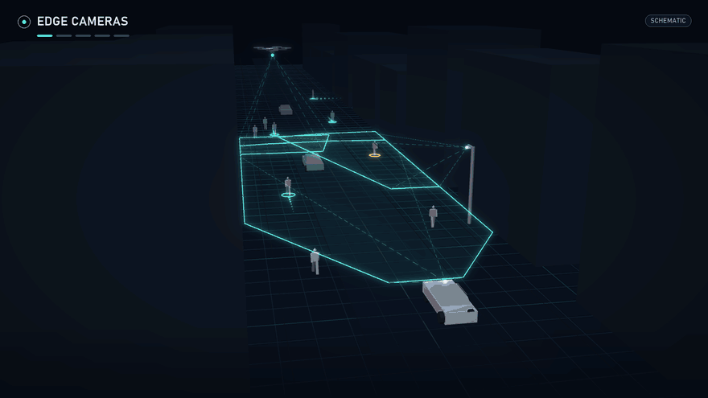
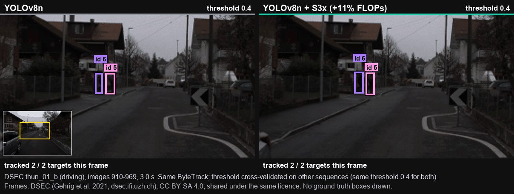
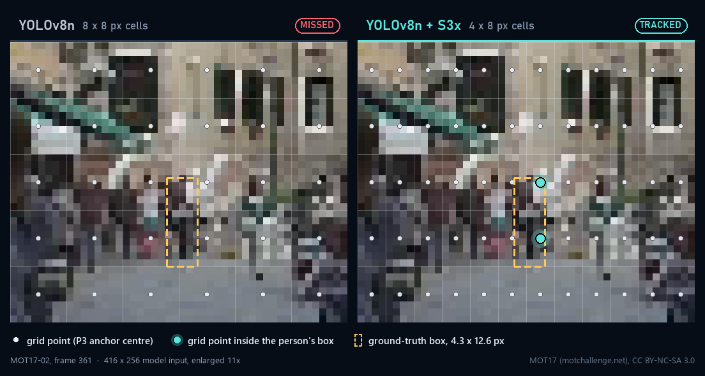
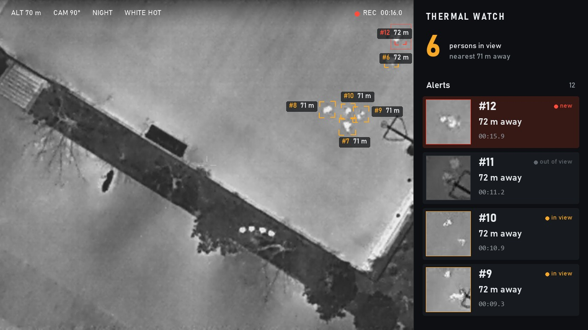

# Edge tracking of far, small pedestrians

**English** | [한국어](README_ko.md)



*An illustration rendered from a synthetic scene, not real data. On a 416 x 256 edge input (low resolution), a
far pedestrian is about 4 px wide and can fall between the 8 px P3 grid points (the locations where YOLOv8's finest detection layer makes a prediction); S3x halves the horizontal spacing.
Real clips and measured results follow below.*

This repository tracks far, small pedestrians with detectors small enough for edge devices. To fit that compute
budget, frames are downscaled before detection to 416 x 320 (DSEC, from 640 x 480) or 416 x 256 (16:9 video such as
BDD100K, from 1280 x 720); this detector input size is called the canvas below.
YOLOv8n and YOLO11n make their finest predictions on a grid of points spaced 8 px apart (the P3 layer). A far
pedestrian is often only 4–5 px wide, so it can fall between two points and be missed: its **short side, the width,**
is what decides detection. **S3x** changes four strides inside the detector (no new operator) so that these points sit
every 4 px horizontally (still 8 px vertically), for about +11 % FLOPs. The main model of this repository is YOLOv8n
with S3x (YOLOv8n + S3x), still a YOLOv8n-sized model with 2.9 M parameters. Yet on DSEC its pedestrian HOTA (the
standard multi-object tracking score, 0-100) is within 0.4 points of the larger YOLOv8s, and the difference is not
significant. YOLOv8s has 3.8 times the parameters and takes 46 % longer per frame on a Jetson Orin Nano (4.79 vs
3.27 ms).

It is evaluated on four datasets (DSEC and BDD100K driving video, VisDrone drone video, MOT17 street scenes) with two
unmodified trackers, ByteTrack and OC-SORT. Tracker thresholds are chosen on sequences other than the ones being scored
(cross-fitting), models are compared with paired statistical tests, and latency is measured on a Jetson Orin Nano. As
an application, [Thermal Watch](apps/thermal_watch/README.md) searches night thermal drone video for people, tracks
them and raises an alert when it confirms a new person ([demo video](https://youtu.be/e3jIqR9ppsA)).



*A selected best case (selection rule: [`demo/README.md`](demo/README.md)). In DSEC sequence thun_01_b, with the
same ByteTrack threshold for both models, plain YOLOv8n tracks the two far pedestrians (about 8 x 20 px on the
416 x 320 input) in 14 % of the frames where they appear, YOLOv8n + S3x in 100 %. Averages over all sequences are in
the results table below.*
*Frames: DSEC (https://dsec.ifi.uzh.ch), CC BY-SA 4.0 (https://creativecommons.org/licenses/by-sa/4.0/); cropped,
enlarged and annotated with model tracks; the clip is shared under CC BY-SA 4.0.*

## Overview

- **Finding.** On small canvases, whether a far object is detected depends on its shorter side, not its area: the
  width for pedestrians, the height for cars. With frames scaled to 416 px on the long side, 76 % of VisDrone
  pedestrians have a shorter side under 8 px.
- **Module.** S3x makes the P3 grid twice as fine along the pedestrian's short axis (horizontally) by changing four
  strides in the existing YOLOv8n graph. It adds no new operator, leaves P4 and P5 unchanged, costs 11 % more FLOPs
  and exports to ONNX / TensorRT as is. S3y, which refines the vertical axis instead, serves as the control.
- **Result.** Pedestrian HOTA is higher than with the plain model of the same canvas on every dataset (+1.65 to +6.24;
  significant everywhere except MOT17 with ByteTrack). S3x also beats the plain model on a larger input of the same
  FLOPs on DSEC and BDD100K; on MOT17 and VisDrone the difference is not significant.
- **Edge cost.** On a Jetson Orin Nano (TensorRT FP16, detector engine) S3x takes 3.26 ms (307 FPS) instead of
  2.94 ms (340 FPS).
- **Other detectors (DSEC).** S3x is within 0.4 HOTA of YOLOv8s and 0.9 of YOLOX-Tiny (not significant, equivalence
  not shown), ahead of YOLO11n, YOLO26n, YOLOX-Nano and NanoDet-Plus-m, and behind RT-DETR-L (8x slower). None of the
  compared detectors is both faster on the Jetson and more accurate.
- **Application.** Thermal Watch, person search in night thermal drone video
  ([`apps/thermal_watch`](apps/thermal_watch/README.md)). On HIT-UAV recordings unseen in training, S3x raises person
  AP50 from 55.8 to 62.9.

## Key finding: the short side decides

During training, YOLOv8's task-aligned assigner (TAL) lets only the prediction points (anchors) inside an object's box
learn that object. On P3 these points are 8 px apart, so a pedestrian narrower than that can sit between two columns of
points, get no anchor assigned (no positive sample), and be learned as background.



*MOT17-02, frame 361: a pedestrian 4.3 x 12.6 px at the 416 x 256 input has no plain P3 anchor centre inside its box
and two with S3x. Frame and annotation: MOT17 (https://motchallenge.net), CC BY-NC-SA 3.0
(https://creativecommons.org/licenses/by-nc-sa/3.0/); cropped, enlarged and annotated; non-commercial use only.*

- A logistic regression of "detected" on each object's log width and log height on the 416 x 320 canvas (plain
  YOLOv8n, DSEC validation set) gives pedestrians a width coefficient of +2.57 (SE 0.48) and a height coefficient of
  +0.15 (SE 0.54): their detection depends on the width. For cars it is the reverse (+0.03 and +2.87). The analysis
  code is not in the repository.
- Ground-truth geometry (`python -B scripts/short_side_stats.py`): with frames scaled to 416 px on the long side,
  76 % of VisDrone pedestrians, 37 % of VisDrone cars and 18 % of MOT17 pedestrians have a shorter side under 8 px;
  for 98 % of the VisDrone and 100 % of the MOT17 pedestrians the shorter side is the width.

Details: [`docs/METHOD.md`](docs/METHOD.md).

## Method: S3x, a horizontally finer P3 grid

| layer (YOLOv8n, strides as (y, x)) | plain | S3x |
|---|---|---|
| 3: Conv P2 -> P3 | (2, 2) | **(2, 1)** |
| 5: Conv P3 -> P4 | (2, 2) | **(2, 4)** |
| 13: Upsample P4 -> P3 | 2 | **(2, 4)** |
| 16: Conv P3 -> P4 (bottom-up) | (2, 2) | **(2, 4)** |
| P3 head width | 64 ch | **32 ch** |
| P3 grid at 416 x 320 | 40 x 52 | 40 x 104 |

- Anchors, box decoding and the loss are per-axis (`AnisoDetect`, `AnisoV8Loss`); everything else is the Ultralytics
  8.3.170 pipeline. All backbone and neck weights load from the COCO checkpoint.
- YOLO11n port: the same edits at layers 3, 5, 14 and 17, P3 head 24 channels (+11.0 % FLOPs).
- Cost at 416 x 320: 2.665 -> 2.955 GFLOPs (+10.9 %).

Code: [`efpmot/models`](efpmot/models). Design notes and prior work: [`docs/METHOD.md`](docs/METHOD.md).

## Results

### Tracking accuracy (cross-fitted thresholds, paired tests)

Each cell is the pedestrian HOTA of S3x minus that of the plain model, ByteTrack / OC-SORT, over all seeds (2-3 per
model). n.s. = not significant (Holm-adjusted randomisation test, p >= 0.05); every other difference is a significant
win for S3x.

| dataset (test set) | detector, canvas | S3x vs. plain, same canvas (S3x minus plain) | S3x vs. plain at a larger canvas of the same cost (S3x minus plain) |
|---|---|---|---|
| DSEC-Det test (13 sequences from 8 drives) | YOLOv8n, 416 x 320 | +5.88 / +5.49 | +2.24 / +2.81 (448 x 352) |
| BDD100K MOT val (200 videos) | YOLOv8n, 416 x 256 | +2.52 / +2.56 | +1.54 / +1.37 (480 x 256) |
| VisDrone2019-MOT test-dev (17 clips) | YOLOv8n, 640 x 384 | +2.58 / +3.05 | +0.07 / +0.22, n.s. (704 x 384) |
| MOT17 train, evaluation halves (7 sequences) | YOLOv8n, 416 x 256 | +2.70, n.s. (p 0.125) / +2.12 | -0.51 / +0.77, n.s. (480 x 256) |

- **Same cost** means matched on FLOPs: the larger plain input costs 4 to 7 % more than S3x (VisDrone 0.8 % less).
- **YOLO11n** + S3x vs plain: DSEC +6.24 / +4.84, BDD100K +1.65 / +1.89.
- **Cars** gain against the plain model on DSEC and BDD100K (not significant for YOLO11n with OC-SORT on DSEC) and not
  on VisDrone; against the same-cost canvas no car difference is significant.
- **Limit: with about twice the compute, a larger input is better.** Plain YOLOv8n on a 640-wide canvas (about 2.1x
  the FLOPs of S3x) is ahead of S3x on pedestrians (plain 640 minus S3x: DSEC +5.25 / +5.10, BDD100K +3.06 / +3.38;
  significant on BDD100K, not significant after Holm correction on DSEC), but it is also slower on the Jetson Orin Nano
  (4.72 vs 3.26 ms, 212 vs 307 FPS). S3x is an improvement
  within a small edge budget, not a replacement for a larger input when the budget allows one.
- **Pre-registered tests.** For VisDrone and MOT17 the predictions were written down before any training on them
  ([`docs/PREREGISTRATION.md`](docs/PREREGISTRATION.md)); a prediction holds only if it is significant with both
  trackers. On VisDrone, S3x beats the plain model (P1) and S3y (P2). On MOT17 it beats S3y, but the win over the
  plain model is not shown (ByteTrack p 0.062). Whether S3x beats the same-cost larger input (P4) stays open on both.
- **Drive-level check.** The 13 DSEC test sequences come from only 8 drives, and sequences of one drive are not
  independent. Repeating the test with whole drives as the unit keeps the sign and size of the pedestrian result (S3x minus
  plain +5.88, unadjusted p 0.016). With only 8 drives no drive-level difference can pass the Holm correction, so this
  check is reported but does not decide.

All 64 comparisons with intervals, p-values and labels: [`results/RESULTS.md`](results/RESULTS.md). Protocol:
[`docs/PROTOCOL.md`](docs/PROTOCOL.md).

### Compared with other lightweight detectors (DSEC)

Pedestrian HOTA on DSEC-Det test with each tracker, 416 x 320 canvas, same training data, iterations and protocol as
above. "S3x minus detector" is the HOTA of S3x minus that of the row's detector with the same tracker (positive: S3x
is better); n.s. = not significant after Holm correction over the 11 comparisons in this table, every other difference
is significant. None of them is shown to be equivalent to S3x (TOST, margin 1.2 HOTA).

| detector | params [M] | GFLOPs | Jetson FP16 [ms] | FPS | HOTA (ByteTrack) | HOTA (OC-SORT) | S3x minus detector (ByteTrack) | S3x minus detector (OC-SORT) |
|---|---|---|---|---|---|---|---|---|
| YOLOX-Nano | 0.90 | 0.83 | 3.12 | 321 | 24.47 | 24.22 | +9.34 | +10.20 |
| NanoDet-Plus-m | 1.17 | 1.20 | 4.69 | 213 | 23.89 | 21.47 | +9.91 n.s. | +12.94 |
| YOLO26n | 2.38 | 1.74 | 3.64 | 275 | 28.82 | 30.16 | +4.99 | +4.25 |
| YOLO11n | 2.59 | 2.10 | 3.49 | 287 | 28.29 | 28.84 | +5.52 | +5.58 |
| YOLOv8n | 3.01 | 2.66 | 2.94 | 340 | 27.92 | 28.93 | +5.88 | +5.49 |
| **YOLOv8n + S3x** | 2.92 | 2.95 | 3.27 | 306 | **33.80** | **34.42** | | |
| YOLOX-Tiny | 5.06 | 4.96 | 3.90 | 256 | 33.61 | 33.58 | +0.19 n.s. | +0.84 n.s. |
| YOLOv8s | 11.14 | 9.31 | 4.79 | 209 | 34.15 | 34.03 | -0.35 n.s. | +0.39 n.s. |
| RT-DETR-L | 32.82 | 39.03 | 26.70 | 37 | 39.98 | 40.27 | -6.17 | -5.86 |

- The latencies come from a second Jetson session (S3x 3.27 ms there, 3.26 ms in the latency table below).
- The model code of YOLOX, NanoDet-Plus, YOLO26n, YOLOv8s and RT-DETR-L is not in this repository, so they cannot be
  retrained here; their rows are regenerated from the statistics in `results/stats`.
- Seeds: 2 for S3x, YOLO11n and YOLO26n, 3 for the others. Intervals, the 448 x 352, P2 and 640 models and car results:
  [`results/DETECTORS.md`](results/DETECTORS.md).

### Latency on a Jetson Orin Nano

TensorRT 10.3, FP16, batch 1, 15 W mode; GPU compute time of the detector engine only (median of trtexec; no
pre-processing, NMS or tracking). FPS = 1000 / ms, the ceiling set by the engine alone, not the frame rate of
the whole pipeline.

| model | canvas (W x H) | ms | FPS |
|---|---|---|---|
| YOLOv8n | 416 x 320 | 2.94 | 340 |
| YOLOv8n + S3x | 416 x 320 | 3.26 | 307 |
| YOLOv8n, larger canvas (FLOPs ≈ S3x) | 448 x 352 | 3.13 | 319 |
| YOLOv8n + P2 level (reference, code not included) | 416 x 320 | 4.51 | 222 |
| YOLOv8n | 640 x 480 | 4.72 | 212 |
| INT8 plain / S3x (built without calibration data, so only the latency counts) | 416 x 320 | 2.34 / 2.71 | 427 / 369 |

The same-cost 448 x 352 engine is slightly faster than S3x (3.13 vs 3.26 ms, 319 vs 307 FPS): FLOPs are not
latency. Export and benchmark scripts: [`deploy/jetson`](deploy/jetson/README.md).

## Demo

| clip | what |
|---|---|
| [`demo/dsec_clear_1.gif`](demo/dsec_clear_1.gif) | DSEC, two far pedestrians, crop, 3 s (above) |
| [`demo/dsec_compare_2.gif`](demo/dsec_compare_2.gif) | DSEC, same scene, full frame + 2x zoom, 7 s |
| [`demo/mot17_clear_1.gif`](demo/mot17_clear_1.gif) | MOT17-10, one far pedestrian, moving camera, 3 s |
| [`demo/grid_explainer.png`](demo/grid_explainer.png) | P3 anchor centres on a narrow pedestrian (above) |
| [Thermal Watch demo (YouTube)](https://youtu.be/e3jIqR9ppsA) | the app on HIT-UAV thermal drone video, live and review screens, 43 s (below) |

The DSEC and MOT17 clips are selected best cases, chosen by a fixed rule from all windows of the evaluation sequences;
the rule, the counts behind each caption and how rare such cases are: [`demo/README.md`](demo/README.md). No
ground-truth box is drawn on the DSEC clips. The Thermal Watch scenes were picked by hand to show the app's screens
([`apps/thermal_watch/README.md`](apps/thermal_watch/README.md)).

## Application: Thermal Watch

[](https://youtu.be/e3jIqR9ppsA)

*Demo video (43 s, YouTube): the live screen on two HIT-UAV night flights (70 m and 130 m altitude), then the review
screen. Neither recording was used for training. Footage: HIT-UAV (Suo et al., Scientific Data 2023), CC BY 4.0.*

[`apps/thermal_watch`](apps/thermal_watch/README.md) runs S3x on thermal (LWIR, 640 x 512) drone video. It tracks
people after subtracting the drone's own motion, raises an alert with a snapshot and an estimated distance when it
confirms a new person (a person lost for more than 6 s raises a second alert), and keeps every alert on a review
timeline. It is meant for night search and perimeter watch: the review screen lists every sighting with its time, so
nobody has to scrub through the recording. HIT-UAV has no track IDs, so the detector is scored on its own, on
recordings unseen in training (416 x 320 canvas):

| | YOLOv8n | YOLOv8n + S3x |
|---|---|---|
| Person AP50, unseen recordings (2 folds x 3 seeds) | 55.8 | **62.9** |
| Person AP50, unseen altitude (trained at 60-90 m, tested at 100-130 m) | 28.5 | **34.1** |

Plain YOLOv8n on a same-cost 448 x 352 canvas reaches 60.2 and 28.8. All models and seeds:
[`results/HITUAV.md`](results/HITUAV.md).

## Installation

```bash
# 1. PyTorch with CUDA from https://pytorch.org (pip from PyPI gives a CPU-only build on Windows)
# 2. this package (Python 3.10-3.13)
pip install -e .            # add .[dev] for the FLOPs test, .[deploy] for the ONNX export
# 3. tests (CPU, no dataset needed; data-dependent tests are skipped)
python -B -m unittest discover -s tests
python -B apps/thermal_watch/tests/test_thermal_watch.py
```

Tested with Python 3.10, torch 2.8.0 + CUDA 12.9, ultralytics 8.3.170 and boxmot 25.0.0 (both pinned).

## Data

No dataset is included. [`docs/DATA.md`](docs/DATA.md) explains where to get DSEC-Detection, MOT17, VisDrone2019-MOT,
BDD100K and HIT-UAV, their terms, the expected layout and the conversion (`scripts/prepare_data.py`). Paths are set in
`configs/paths.yaml`, copied from `configs/paths.example.yaml` (or a file named by `EFPMOT_PATHS`).

## Reproducing the results

Every table of `results/RESULTS.md`, `results/DETECTORS.md` and `results/HITUAV.md` is regenerated on CPU in about a
minute from the shipped statistics, without any dataset:

```bash
python -B scripts/compare.py --table results/contrasts.yaml
python -B scripts/compare.py --detectors results/contrasts_detectors.yaml
python -B scripts/evaluate_hituav.py --table
```

- One comparison as JSON: `python -B scripts/compare.py --one dsec v8n 416s3x 416 --cls pedestrian --trk bytetrack`.
- Evaluating the release weights and the full pipeline (train, export detections, track, TrackEval, compare):
  [`docs/REPRODUCE.md`](docs/REPRODUCE.md).
- How this code was checked against the original research outputs: [`docs/PORT_VERIFICATION.md`](docs/PORT_VERIFICATION.md).
- Alternatives that were tried and dropped: [`docs/EXPERIMENTS_LOG.md`](docs/EXPERIMENTS_LOG.md).

## Pretrained weights

Eight YOLOv8n checkpoints (seed 0) are published on the GitHub Releases page of this repository, with
[`release_assets/MODEL_CARD.md`](release_assets/MODEL_CARD.md) and `SHA256SUMS.txt`:

| file | trained on | canvas (W x H) |
|---|---|---|
| `yolov8n_plain_dsec_416x320_s0.pt` / `yolov8n_s3x_dsec_416x320_s0.pt` | DSEC-Det train | 416 x 320 |
| `yolov8n_plain_mot17_416x256_s0.pt` / `yolov8n_s3x_mot17_416x256_s0.pt` | MOT17 train, first halves | 416 x 256 |
| `yolov8n_plain_hituav-recA_416x320_s0.pt` / `yolov8n_s3x_hituav-recA_416x320_s0.pt` | HIT-UAV fold recA, train part | 416 x 320 |
| `yolov8n_plain_hituav-recB_416x320_s0.pt` / `yolov8n_s3x_hituav-recB_416x320_s0.pt` | HIT-UAV fold recB, train part | 416 x 320 |

Put them in `release_assets/` (`sha256sum -c SHA256SUMS.txt`) and load them with
`efpmot.models.build("yolov8n_s3x", 8, "release_assets/yolov8n_s3x_dsec_416x320_s0.pt")`. The weights carry the terms
of their training data: the MOT17 files are for non-commercial research use only, the DSEC-Detection labels state no
licence, and the HIT-UAV files need attribution (CC BY 4.0; see the model card). No weights trained on VisDrone or
BDD100K are released.

## Repository layout

```
efpmot/               Python package: models (S3x / S3y), data readers, training, tracking, evaluation protocol
scripts/              command-line entry points: prepare_data, train, export_dets, track, evaluate, compare, ...
configs/              paths.example.yaml (copy to paths.yaml)
results/              comparison lists (contrasts*.yaml), per-run statistics (stats/, hituav/), generated tables (RESULTS, DETECTORS, HITUAV)
docs/                 METHOD, PROTOCOL, PREREGISTRATION, DATA, REPRODUCE, PORT_VERIFICATION, EXPERIMENTS_LOG
demo/                 demo clips and the grid figure
deploy/jetson/        ONNX export, TensorRT benchmark script and the measured latency tables
apps/thermal_watch/   Thermal Watch: person search in thermal drone video (live and review screens, demo)
release_assets/       model card and checksums of the release weights (the weights themselves are not committed)
tests/                unit tests (CPU)
```

## Licence and data terms

| what | licence |
|---|---|
| Code and documentation (`efpmot/`, `scripts/`, `apps/thermal_watch/*.py`, `deploy/`, `tests/`, `docs/`) | AGPL-3.0 ([`LICENSE`](LICENSE)), because Ultralytics YOLO and BoxMOT are AGPL-3.0 |
| `demo/dsec_clear_1.*`, `demo/dsec_compare_2.*` | CC BY-SA 4.0 (derived from DSEC frames) |
| `demo/mot17_clear_1.*`, `demo/grid_explainer.*` | CC BY-NC-SA 3.0 (derived from MOT17), non-commercial |
| `apps/thermal_watch/media/`, the demo video, `apps/thermal_watch/sample_videos.json` | CC BY 4.0 (derived from HIT-UAV) |
| `results/` | aggregate evaluation statistics only; no images or labels of any dataset |
| Release weights | the terms in [`release_assets/MODEL_CARD.md`](release_assets/MODEL_CARD.md) |

No dataset images or labels are redistributed except the derived media listed above. VisDrone and BDD100K are
research-only datasets: this repository holds numbers for them and nothing else. Third-party software and method
notices: [`THIRD_PARTY_NOTICES.md`](THIRD_PARTY_NOTICES.md).

## Citation

See [`CITATION.cff`](CITATION.cff), or:

```bibtex
@software{jeung2026efpmot,
  author  = {Jeung, In Ho},
  title   = {edge-far-pedestrian-mot: anisotropic P3 grids for tracking far, small pedestrians on edge devices},
  year    = {2026},
  version = {0.2.0}
}
```

## Author

In Ho Jeung
