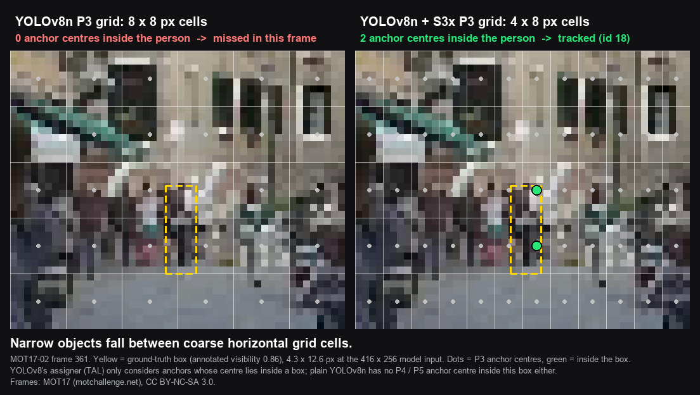

# 멀리 있는 작은 보행자의 엣지 다중 객체 추적 (한국어 요약)

엣지 장치용 검출기의 작은 입력 크기에서 멀리 있는 보행자를 추적하는 프로젝트입니다. 이 문서는 요약이며, 수치와
절차의 기준은 영어 [`README.md`](README.md)와 [`results/RESULTS.md`](results/RESULTS.md)입니다.


*효과가 잘 드러나는 구간을 정해진 규칙으로 고른 장면입니다(선정 규칙: [`demo/README.md`](demo/README.md)). 같은
ByteTrack 임계값에서 기본 YOLOv8n은 두 보행자(416 x 320 입력에서 약 8 x 20 px)를 등장 프레임의 14 %에서, YOLOv8n +
S3x는 100 %에서 추적합니다. 평균 수치는 아래 결과 표에 있습니다.*
*영상: DSEC (https://dsec.ifi.uzh.ch), CC BY-SA 4.0 (https://creativecommons.org/licenses/by-sa/4.0/). 잘라 내고
확대한 뒤 모델의 추적 결과를 그려 넣었으며, 같은 CC BY-SA 4.0으로 공유합니다.*

## 핵심 발견: 객체의 짧은 변이 검출 여부를 좌우합니다

엣지용 검출기는 입력 해상도가 작아서, 멀리 있는 보행자는 입력 영상에서 폭이 몇 픽셀에 불과합니다. 측정해 보니 검출
여부를 가르는 것은 면적이 아니라 짧은 변의 길이였고, 짧은 변이 P3 격자 간격(8 px)보다 작아지면 검출이 크게
떨어졌습니다. 보행자는 폭이, 자동차는 높이가 짧은 변입니다.

- YOLOv8의 할당기(TAL)는 중심이 정답 상자 안에 있는 앵커만 후보로 씁니다. 폭이 8 px보다 좁은 상자는 두 앵커 열
  사이에 끼어 학습 때 배경으로 취급될 수 있습니다.
- 정답 상자 통계(`python -B scripts/short_side_stats.py`): 긴 변을 416 px로 맞추면 VisDrone 보행자의 76 %, MOT17
  보행자의 18 %가 짧은 변 8 px 미만입니다.



*MOT17-02, 361번 프레임. 416 x 256 입력에서 4.3 x 12.6 px인 보행자 상자 안에 기본 모델의 P3 앵커 중심은 하나도 없고,
S3x에서는 두 개가 들어갑니다. 영상과 주석: MOT17 (https://motchallenge.net), CC BY-NC-SA 3.0
(https://creativecommons.org/licenses/by-nc-sa/3.0/), 비상업적 이용만 허용됩니다.*

## 방법: S3x (가로 방향으로 촘촘한 P3 격자)

YOLOv8n의 P3 단계에서 가로 격자만 두 배로 촘촘하게 바꿨습니다(세로 stride 8, 가로 stride 4). 기존 그래프 안에서
stride 네 곳을 바꾼 것이라 새 연산자는 없고, P4 / P5는 그대로이며, FLOPs는 11 % 늘어납니다. 앵커, 상자 복원, 손실은
축마다 따로 계산합니다. YOLO11n에도 같은 방식으로 옮겼고, 세로 방향을 촘촘하게 한 S3y를 대조군으로 두었습니다.
자세한 내용은 [`docs/METHOD.md`](docs/METHOD.md)에 있습니다.

## 결과

보행자 HOTA 차이 d, ByteTrack / OC-SORT 순서이며, 추적기 임계값은 평가 시퀀스 밖에서 고른 값(cross-fitting)입니다.
n.s.는 통계적으로 유의하지 않다는 뜻이고(Holm 보정 무작위화 검정 p >= 0.05), 나머지는 모두 유의한 차이입니다.

| 데이터셋 | 같은 입력 크기의 기본 모델 대비 | 연산량이 같은 큰 입력 대비 |
|---|---|---|
| DSEC-Det test (8개 주행에서 나온 13개 시퀀스) | +5.88 / +5.49 | +2.24 / +2.81 (448 x 352) |
| BDD100K MOT val | +2.52 / +2.56 | +1.54 / +1.37 (480 x 256) |
| VisDrone2019-MOT test-dev | +2.58 / +3.05 | +0.07 / +0.22, n.s. (704 x 384) |
| MOT17 학습 시퀀스 후반부 | +2.70, n.s. / +2.12 | -0.51 / +0.77, n.s. (480 x 256) |

- DSEC 보행자 HOTA는 같은 입력 크기의 기본 모델보다 +5.88(ByteTrack) / +5.49(OC-SORT) 높습니다.
- 연산량을 맞춘 큰 입력(448 x 352)보다도 +2.24 / +2.81 높습니다. 다만 MOT17과 VisDrone에서는 통계적으로 차이가
  없습니다.
- 640 폭의 입력(FLOPs 약 2.1배)은 여전히 S3x보다 높습니다(DSEC 보행자 +5.25 / +5.10).
- VisDrone과 MOT17은 학습 전에 예측을 미리 등록해 두고 검증했습니다([`docs/PREREGISTRATION.md`](docs/PREREGISTRATION.md)).
- 데모 영상은 효과가 잘 드러나는 구간을 고른 것이고, 평균 수치는 [`results/RESULTS.md`](results/RESULTS.md)에
  있습니다.

## Jetson Orin Nano 지연 시간

TensorRT FP16, 배치 1, 검출기 엔진만 잰 GPU 연산 시간(중앙값)입니다. 전처리, NMS, 추적은 포함하지 않았습니다.

| 모델 | 입력 (W x H) | ms |
|---|---|---|
| YOLOv8n | 416 x 320 | 2.94 |
| YOLOv8n + S3x | 416 x 320 | 3.26 |
| YOLOv8n | 448 x 352 | 3.13 |
| YOLOv8n | 640 x 480 | 4.72 |

카메라 입력부터 경보까지 전체 파이프라인은 Jetson에서 측정하지 않았습니다.

## 응용: 구역 침입·배회 경보

[`apps/zone_alert`](apps/zone_alert/README.md)는 카메라 영상에 그린 구역에 사람이 들어오면 침입 경보를, 정해진 시간
이상 머물면 배회 경보를 냅니다. MOT17 두 시퀀스(시드 1개, 신뢰구간 없음)에서 먼 구역 진입 48건 중 S3x가 40건, 기본
모델이 39건을 잡아 비슷했고, 오경보는 28건 대 42건으로 S3x가 적었습니다. 연구용 시제품이며, 실제 CCTV에 쓰기 전에
해당 국가의 개인정보·영상 감시 관련 법을 확인해야 합니다.

## 설치와 재현

```bash
# PyTorch(CUDA)를 https://pytorch.org 안내대로 먼저 설치한 뒤
pip install -e .
python -B -m unittest discover -s tests                        # CPU, 데이터셋 불필요
python -B scripts/compare.py --table results/contrasts.yaml    # 결과 표 전체를 CPU에서 다시 생성
```

데이터셋은 포함하지 않습니다. 내려받는 곳과 변환 방법은 [`docs/DATA.md`](docs/DATA.md), 전체 재현 절차는
[`docs/REPRODUCE.md`](docs/REPRODUCE.md)에 있습니다.

## 가중치

DSEC와 MOT17로 학습한 YOLOv8n 가중치 4개(기본 모델과 S3x, 시드 0)를 이 저장소의 GitHub Releases에 올립니다. 이용
조건은 [`release_assets/MODEL_CARD.md`](release_assets/MODEL_CARD.md)에 있습니다. MOT17 가중치는 비상업적 연구용으로만
쓸 수 있고, DSEC-Detection 라벨에는 명시된 라이선스가 없습니다.

## 라이선스와 데이터 조건

- 코드: AGPL-3.0 (Ultralytics YOLO, BoxMOT가 AGPL-3.0이기 때문입니다).
- DSEC 데모 영상: CC BY-SA 4.0. MOT17에서 만든 영상, 그림, 구역 경보 자료: CC BY-NC-SA 3.0(비상업적 이용만).
- VisDrone, BDD100K: 연구용 데이터셋이라 수치만 싣고 영상과 가중치는 배포하지 않습니다.

자세한 내용은 [`README.md`](README.md)의 라이선스 절과 [`THIRD_PARTY_NOTICES.md`](THIRD_PARTY_NOTICES.md)를 보십시오.

## 작성자

In Ho Jeung
