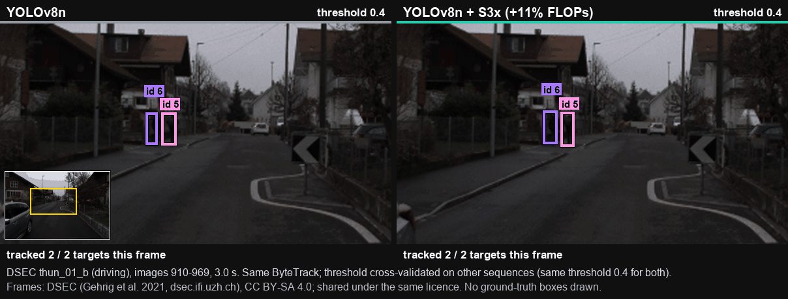

# Edge tracking of far, small pedestrians (한글 요약)

[English](README.md) | **한국어**


*이해를 돕기 위해 만든 설명용 애니메이션(실제 데이터가 아님). Edge device의 416 x 256 입력(저해상도)에서 멀리 있는 보행자는 폭이 약 4 px라서, 8 px 간격의 P3(YOLOv8에서 가장 촘촘한 검출 layer) 격자 점 사이로 빠질 수 있다. S3x는 이 가로 간격을 절반으로 줄인다. 실제 영상과 측정 결과는 아래에 첨부하였다.*

멀리 있는 작은 보행자를 Edge device에서 다중 객체 추적하는 프로젝트다. 작은 연산 예산에 맞추려고 원본 영상을 416 x 320(DSEC, 원본 640 x 480)이나 416 x 256(16:9 영상, 예: BDD100K 원본 1280 x 720) 크기로 줄여 검출기에 넣는다. 이 크기를 아래에서는 입력 크기라고 부른다. YOLOv8n과 YOLO11n은 8 px 간격의 격자 점(P3 layer)에서 가장 촘촘한 예측을 낸다. 멀리 있는 보행자는 폭이 4~5 px에 불과한 경우가 많아, 두 점 사이에 놓여 검출되지 않을 수 있다. 검출 여부를 가르는 것은 **짧은 변, 즉 폭**이다. **S3x**는 검출기 안의 stride 네 곳을 바꿔(새 연산자 없음) 이 점을 가로로 4 px마다(세로는 그대로 8 px) 두는 수정이고, FLOPs는 약 11 % 늘어난다. 이 저장소의 주 모델은 YOLOv8n에 S3x를 적용한 YOLOv8n + S3x로, 파라미터가 2.9M인 YOLOv8n 크기 그대로다. 그런데도 DSEC 보행자 HOTA(다중 객체 추적의 표준 정확도 지표, 0~100)에서 더 큰 모델인 YOLOv8s와의 차이는 0.4점 이내이고, 통계적으로 유의하지 않다. YOLOv8s는 파라미터가 3.8배이고 Jetson Orin Nano에서 한 프레임에 46 % 더 걸린다(4.79 대 3.27 ms).

네 가지 데이터셋(DSEC·BDD100K 주행 영상, VisDrone 드론 영상, MOT17 거리 영상)에서 평가했다. 추적기(ByteTrack, OC-SORT)는 수정 없이 그대로 썼고, 추적기 임계값은 평가 시퀀스 밖에서 골랐으며(cross-fitting), 모델 비교에는 같은 시퀀스끼리 짝지어 비교하는 통계 검정(paired test)을 썼다. Jetson Orin Nano에서는 지연 시간을 쟀다. 응용 프로젝트로, 야간 열화상 드론 영상에서 사람을 찾아 추적하고 새 사람을 확인할 때마다 경보를 내는 [Thermal Watch](apps/thermal_watch/README.md)를 넣었다([데모 영상](https://youtu.be/e3jIqR9ppsA)).

이 문서는 요약본이고, 수치와 자세한 절차는 영문 [`README.md`](README.md)와 [`results/RESULTS.md`](results/RESULTS.md)를 기준으로 한다.



*효과가 잘 드러나는 구간을 정해진 규칙으로 고른 장면이다(선정 규칙: [`demo/README.md`](demo/README.md)). 같은 ByteTrack 임계값에서 기본 YOLOv8n은 두 보행자(416 x 320 입력에서 약 8 x 20 px)를 각자 나오는 프레임의 14 %에서만 추적하고, YOLOv8n + S3x는 100 %에서 추적한다. 평균 수치는 아래 결과 표에 있다.*
*영상: DSEC (https://dsec.ifi.uzh.ch), CC BY-SA 4.0 (https://creativecommons.org/licenses/by-sa/4.0/). 원본 영상을 잘라 확대한 뒤 모델의 추적 결과를 그려 넣었으며, 원본 라이선스(CC BY-SA 4.0)에 따라 이 GIF도 같은 라이선스로 공개한다.*

## 핵심 발견: 객체의 짧은 변이 검출 여부를 좌우한다

Edge device용 검출기는 입력 해상도가 작아서, 멀리 있는 보행자는 입력 영상에서 폭이 몇 픽셀에 불과하다. 측정해 본 결과, 검출 여부를 가르는 것은 물체 상자의 면적이 아니라 짧은 변의 길이였고, 짧은 변이 P3 격자 간격(8 px)보다 작아지면 검출이 크게 떨어졌다. 보행자는 폭이, 자동차는 높이가 짧은 변에 해당한다.

학습할 때 YOLOv8의 assigner(TAL, task-aligned assigner)는 물체의 정답 상자 안에 중심이 들어오는 예측 지점(앵커)에만 그 물체를 학습시킨다. P3에서는 이 지점들이 8 px 간격이어서, 폭이 이보다 좁은 보행자는 두 지점 열 사이에 놓여, 이 물체에 대해 학습할 앵커를 하나도 배정받지 못하고 오히려 배경으로 학습될 수 있다.


*MOT17-02, 361번 프레임. 416 x 256 입력에서 4.3 x 12.6 px인 보행자 상자 안에 기본 모델의 P3 앵커 중심은 하나도 없고, S3x에서는 두 개가 들어간다. 영상과 주석: MOT17 (https://motchallenge.net), CC BY-NC-SA 3.0 (https://creativecommons.org/licenses/by-nc-sa/3.0/), 비상업적 이용만 허용된다.*

- 정답 상자의 통계(`python -B scripts/short_side_stats.py`): 긴 변을 416 px로 맞추면 VisDrone 보행자의 76 %, MOT17 보행자의 18 %가 짧은 변 8 px 미만이다.

## 방법: S3x (가로 방향으로 촘촘한 P3 격자)

YOLOv8n의 P3 단계에서 가로 격자만 두 배로 촘촘하게 바꿨다(세로 stride 8, 가로 stride 4). 기존 그래프 안에서 stride 네 곳을 바꾼 것이라 새 연산자는 없고, P4 / P5는 그대로이며, FLOPs는 11 % 늘어난다. 앵커, 상자 좌표 계산(디코딩), 손실은 축마다 따로 계산한다. YOLO11n에도 같은 방식으로 옮겼고, 세로 방향을 촘촘하게 한 S3y를 대조군으로 두었다. 자세한 내용은 [`docs/METHOD.md`](docs/METHOD.md)에 있다.

## 결과

표의 값은 보행자 HOTA 차이 d(S3x에서 비교 모델을 뺀 값)이고, ByteTrack / OC-SORT 순서다. 추적기 임계값은 평가 시퀀스 밖에서 고른 값(cross-fitting)이고, 시드는 조건마다 2~3개다. n.s.는 통계적으로 유의하지 않다는 뜻이고(Holm 보정 무작위화 검정 p >= 0.05), 나머지는 모두 유의한 차이다.

| 데이터셋 (test set) | 검출기, 입력 크기 | S3x vs. 같은 입력 크기의 기본 모델 (S3x − 기본) | S3x vs. 연산량이 같은 더 큰 입력의 기본 모델 (S3x − 기본) |
|---|---|---|---|
| DSEC-Det test (8개 주행에서 나온 13개 시퀀스) | YOLOv8n, 416 x 320 | +5.88 / +5.49 | +2.24 / +2.81 (448 x 352) |
| BDD100K MOT val (영상 200개) | YOLOv8n, 416 x 256 | +2.52 / +2.56 | +1.54 / +1.37 (480 x 256) |
| VisDrone2019-MOT test-dev (클립 17개) | YOLOv8n, 640 x 384 | +2.58 / +3.05 | +0.07 / +0.22, n.s. (704 x 384) |
| MOT17 학습 시퀀스의 평가용 후반부 (시퀀스 7개) | YOLOv8n, 416 x 256 | +2.70, n.s. (p 0.125) / +2.12 | -0.51 / +0.77, n.s. (480 x 256) |

- DSEC 보행자 HOTA는 같은 입력 크기의 기본 모델보다 +5.88(ByteTrack) / +5.49(OC-SORT) 높다.
- 연산량을 맞춘 더 큰 입력의 기본 모델보다도 DSEC에서 +2.24 / +2.81(448 x 352), BDD100K에서 +1.54 / +1.37(480 x 256) 높다. MOT17과 VisDrone에서는 통계적으로 차이가 없다.
- **한계: 연산량을 약 두 배로 쓸 수 있다면 큰 입력이 낫다.** 640 폭 입력의 기본 YOLOv8n(S3x의 약 2.1배 FLOPs)은 보행자 추적에서 S3x보다 앞선다(640 기본 − S3x: DSEC +5.25 / +5.10, BDD100K +3.06 / +3.38). 이 차이는 BDD100K에서는 유의하지만, DSEC에서는 Holm 보정 후 유의하지 않다. 대신 Jetson Orin Nano에서 더 느리다(4.72 대 3.26 ms, 212 대 307 FPS). S3x는 Edge device의 작은 연산 예산 안에서의 개선이지, 예산이 허락할 때 큰 입력을 대신하는 방법은 아니다.
- VisDrone과 MOT17은 학습 전에 예측을 미리 등록해 두고 검증했다([`docs/PREREGISTRATION.md`](docs/PREREGISTRATION.md)). 두 추적기 모두에서 유의해야 맞은 것으로 쳤고, VisDrone에서는 S3x가 기본 모델과 S3y보다 높다는 예측이 모두 맞았다. MOT17에서는 S3y보다 높다는 예측만 맞았고, 기본 모델보다 높다는 예측은 ByteTrack에서 유의하지 않아(p 0.062) 입증되지 않았다. 연산량이 같은 더 큰 입력보다 높다는 예측은 두 데이터셋 모두 결론이 나지 않았다.
- 데모 영상은 효과가 잘 드러나는 구간을 고른 것이고, 평균 수치는 [`results/RESULTS.md`](results/RESULTS.md)에 있다.

### 다른 경량 검출기와의 비교 (DSEC)

DSEC-Det test의 보행자 HOTA를 추적기별로 적었다(416 x 320 입력, 학습 데이터·반복 횟수·평가 절차는 위와 같다). 'S3x − 검출기'는 같은 추적기에서 S3x의 HOTA에서 그 행 검출기의 HOTA를 뺀 값으로, +면 S3x가 높다. n.s.는 이 표의 비교 11개에 Holm 보정을 한 뒤 유의하지 않다는 뜻이고, 나머지는 모두 유의하다. 동등성(TOST, 허용 폭 1.2 HOTA)이 입증된 검출기는 없다.

| 검출기 | 파라미터 [M] | GFLOPs | Jetson FP16 [ms] | FPS | HOTA (ByteTrack) | HOTA (OC-SORT) | S3x − 검출기 (ByteTrack) | S3x − 검출기 (OC-SORT) |
|---|---|---|---|---|---|---|---|---|
| YOLOX-Nano | 0.90 | 0.83 | 3.12 | 321 | 24.47 | 24.22 | +9.34 | +10.20 |
| NanoDet-Plus-m | 1.17 | 1.20 | 4.69 | 213 | 23.89 | 21.47 | +9.91 n.s. | +12.94 |
| YOLO26n | 2.38 | 1.74 | 3.64 | 275 | 28.82 | 30.16 | +4.99 | +4.25 |
| YOLO11n | 2.59 | 2.10 | 3.49 | 287 | 28.29 | 28.84 | +5.52 | +5.58 |
| YOLOv8n | 3.01 | 2.66 | 2.94 | 340 | 27.92 | 28.93 | +5.88 | +5.49 |
| **YOLOv8n + S3x** | 2.92 | 2.95 | 3.27 | 306 | **33.80** | **34.42** | | |
| YOLOX-Tiny | 5.06 | 4.96 | 3.90 | 256 | 33.61 | 33.58 | +0.19 n.s. | +0.84 n.s. |
| YOLOv8s | 11.14 | 9.31 | 4.79 | 209 | 34.15 | 34.03 | -0.35 n.s. | +0.39 n.s. |
| RT-DETR-L | 32.82 | 39.03 | 26.70 | 37 | 39.98 | 40.27 | -6.17 | -5.86 |

- S3x보다 Jetson에서 빠르면서 더 정확한 검출기는 없다. RT-DETR-L은 더 정확하지만 8배 느리다.
- 지연 시간은 두 번째 Jetson 측정 세션의 값이다(그 세션에서 S3x 3.27 ms, 아래 지연 표에서는 3.26 ms).
- YOLOX, NanoDet-Plus, YOLO26n, YOLOv8s, RT-DETR-L은 모델 코드가 이 저장소에 없어서 다시 학습할 수는 없고, 표의 수치는 `results/stats`에 저장된 통계로 다시 만들 수 있다. 신뢰구간, 448 x 352·P2·640 비교, 자동차 결과는 [`results/DETECTORS.md`](results/DETECTORS.md)에 있다.

## Jetson Orin Nano 지연 시간

TensorRT 10.3, FP16, 배치 1, 15 W 모드에서 검출기 엔진만 잰 GPU 연산 시간(중앙값)이다. 전처리, NMS, 추적은 포함하지 않았다. FPS는 1000 / ms로 계산한 값이라 엔진만의 상한이고, 전체 파이프라인의 프레임률이 아니다.

| 모델 | 입력 (W x H) | ms | FPS |
|---|---|---|---|
| YOLOv8n | 416 x 320 | 2.94 | 340 |
| YOLOv8n + S3x | 416 x 320 | 3.26 | 307 |
| YOLOv8n, 더 큰 입력 (FLOPs ≈ S3x) | 448 x 352 | 3.13 | 319 |
| YOLOv8n | 640 x 480 | 4.72 | 212 |

연산량이 같은 448 x 352 엔진은 S3x보다 조금 빠르다(3.13 대 3.26 ms, 319 대 307 FPS). FLOPs가 같다고 지연 시간까지 같지는 않다.

## 응용: Thermal Watch

[](https://youtu.be/e3jIqR9ppsA)

**[YouTube에서 데모 영상 보기 (43초)](https://youtu.be/e3jIqR9ppsA)**

*HIT-UAV 야간 비행 두 개(고도 70 m, 130 m)에서 돌린 실시간 화면과 검토 화면이다. 데모 영상의 두 녹화 영상 모두 학습에 쓰지 않았고, 영상에 나오는 두 장면은 예시를 보여 주기 위해 직접 골랐다. 영상: HIT-UAV (Suo et al., Scientific Data 2023), CC BY 4.0.*

[`apps/thermal_watch`](apps/thermal_watch/README.md)는 드론 열화상(LWIR, 640 x 512) 영상에 S3x를 돌려 사람을 찾는다. 드론 움직임을 보정한 좌표에서 사람을 추적하고, 새 사람을 확인하면 확대 조각과 추정 거리를 붙여 경보를 내며(6초 넘게 놓쳤던 사람은 경보가 한 번 더 난다), 모든 경보를 검토 화면의 재생 바에 남긴다. HIT-UAV에는 추적 ID가 없어 추적 성능은 평가할 수 없으므로, 검출 성능만 학습에 쓰지 않은 녹화 영상으로 평가했다(사람 AP50, 416 x 320 입력).

| | YOLOv8n | YOLOv8n + S3x |
|---|---|---|
| 처음 보는 녹화 영상 (fold 2개 x 시드 3개) | 55.8 | **62.9** |
| 처음 보는 고도 (60~90 m로 학습, 100~130 m로 평가) | 28.5 | **34.1** |

연산량이 같은 448 x 352 입력의 기본 모델은 60.2와 28.8이다. 모든 조건의 결과는 [`results/HITUAV.md`](results/HITUAV.md)에 있다.

## 설치와 재현

```bash
# PyTorch(CUDA)를 https://pytorch.org 안내대로 먼저 설치한 뒤
pip install -e .
python -B -m unittest discover -s tests                        # CPU, 데이터셋 불필요
python -B apps/thermal_watch/tests/test_thermal_watch.py       # 앱 테스트, CPU
python -B scripts/compare.py --table results/contrasts.yaml    # 결과 표 전체를 CPU에서 다시 생성
python -B scripts/compare.py --detectors results/contrasts_detectors.yaml   # 다른 검출기 비교표
python -B scripts/evaluate_hituav.py --table                   # HIT-UAV 결과 표
```

데이터셋은 포함하지 않는다. 내려받는 곳과 변환 방법은 [`docs/DATA.md`](docs/DATA.md), 전체 재현 절차는 [`docs/REPRODUCE.md`](docs/REPRODUCE.md)에 있다.

## 가중치

DSEC, MOT17, HIT-UAV(녹화 단위 fold 두 개)로 학습한 YOLOv8n 가중치 8개(기본 모델과 S3x, 시드 0)를 이 저장소의 GitHub Releases에 올려 두었다. 이용 조건은 [`release_assets/MODEL_CARD.md`](release_assets/MODEL_CARD.md)에 있다. MOT17 가중치는 비상업적 용도로만 쓸 수 있고(CC BY-NC-SA 3.0), DSEC-Detection 라벨에는 명시된 라이선스가 없으며, HIT-UAV 가중치는 출처를 밝히고 쓴다(CC BY 4.0).

## 라이선스와 데이터 조건

- 코드: AGPL-3.0 (Ultralytics YOLO, BoxMOT가 AGPL-3.0이기 때문이다).
- DSEC 데모 영상: CC BY-SA 4.0. MOT17에서 만든 영상과 그림: CC BY-NC-SA 3.0(비상업적 이용만). HIT-UAV에서 만든 Thermal Watch 데모 그림·영상과 `sample_videos.json`: CC BY 4.0.
- VisDrone(라이선스 명시 없음), BDD100K(교육·연구·비영리 목적만 허용): 수치만 싣고 영상과 가중치는 배포하지 않는다.

자세한 내용은 [`README.md`](README.md)의 라이선스 절과 [`THIRD_PARTY_NOTICES.md`](THIRD_PARTY_NOTICES.md)에 있다.

## 작성자

In Ho Jeung
