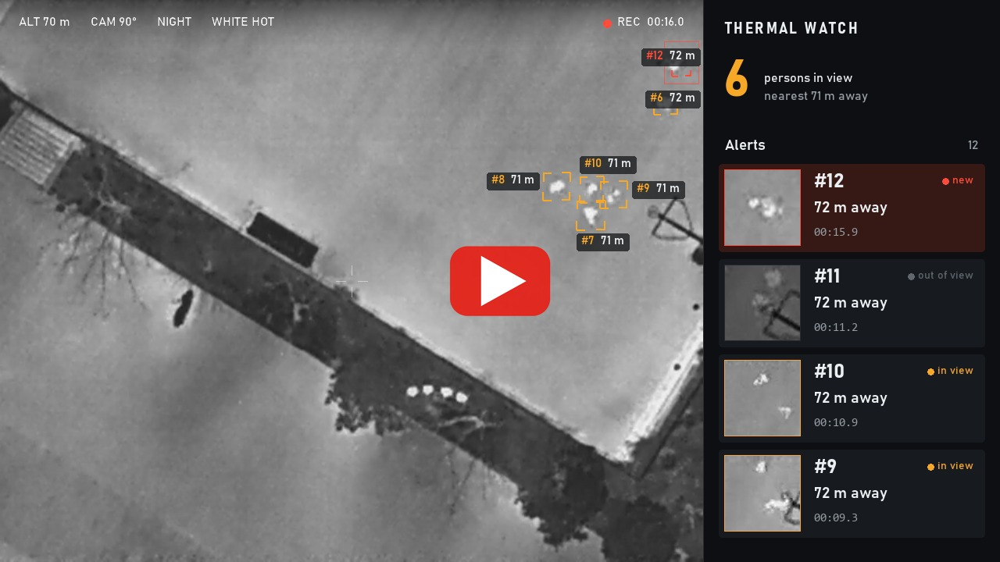

# Thermal Watch: person search in night thermal drone video

[](https://youtu.be/e3jIqR9ppsA)

**[Watch the demo video on YouTube (43 s)](https://youtu.be/e3jIqR9ppsA)**

*The live screen on two HIT-UAV night flights (70 m and 130 m altitude), then the review screen. Neither recording was
used for training. The two scenes were picked by hand; the 120 m sample video, where
the model failed, is left out (see [Limits](#limits)). Footage: HIT-UAV (Suo et al., Scientific Data 2023), CC BY 4.0.*

Thermal Watch runs S3x (YOLOv8n with a horizontally finer P3 grid, see the [main README](../../README.md)) on a drone's
thermal (LWIR, 640 x 512) video. It tracks the people it detects, raises an alert with a snapshot and an estimated
distance when it confirms a new person, and keeps all alerts on a review timeline. It is meant for night search and
perimeter watch: the review screen lists every sighting with its time, so nobody has to scrub through the recording.
From 100 m and higher a person is often fewer than 8 pixels wide on the 416 x 320 detector input, which is where S3x
helps.

## Results on HIT-UAV

HIT-UAV has boxes but no track IDs, so the detector is scored on its own (person AP50, 416 x 320 canvas). Its official
split puts images of the same recording in training and test; here every test recording is unseen in training (two
folds x three seeds; details in [Data and evaluation](#data-and-evaluation)).

| | YOLOv8n | YOLOv8n + S3x |
|---|---|---|
| Person AP50, unseen recordings | 55.8 | **62.9** |
| Person AP50, unseen altitude (trained at 60-90 m, tested at 100-130 m) | 28.5 | **34.1** |
| Jetson Orin Nano FP16, detector engine | 2.94 ms (340 FPS) | 3.26 ms (307 FPS) |

- **Same cost.** A plain model on a 448 x 352 canvas (about the FLOPs of S3x) reaches 60.2 and 28.8.
- **Where the gain is.** It is largest for people whose shorter side is under 8 px (recall 23.6 -> 35.8 %; the
  448 x 352 model: 23.4 %), at 100 m and higher, and with oblique cameras (30-40 deg), where people look tall and thin.
  Straight-down views (80-90 deg) and cars do not gain. S3y, which refines the vertical axis instead, reaches only
  59.9, so the gain comes from the finer horizontal grid.
- **Limit.** YOLOv8n with an extra stride-4 P2 output level, the usual fix for small objects, matches S3x (63.1) but
  takes 4.51 ms (222 FPS). A 640 x 512 input is better still (68.0); it was not timed, but the 640 x 480 engine takes
  4.72 ms (212 FPS).

All models and seeds: [`results/HITUAV.md`](../../results/HITUAV.md).

## Screens

- **Live.** The video fills the screen. Confirmed persons get corner brackets and a number with their distance; a new
  alert turns red for one second. The right side shows the persons in view and the latest alerts as snapshot cards.
- **Review** (`--review`). The whole recording is analysed first with the same pipeline, so every alert is already
  marked on the playback bar and listed on the right. Click a card or a bar mark to jump to that moment.

## Run

Download the release weights (see "Pretrained weights" in the [main README](../../README.md)) into `release_assets/`.
The five sample videos come from the `video_sample` folder of the HIT-UAV repository
([`docs/DATA.md`](../../docs/DATA.md)).

```bash
python -B apps/thermal_watch/thermal_watch.py <video_sample>/130m-60_3.mov --show
```

```bash
python -B apps/thermal_watch/thermal_watch.py <video_sample>/70m-90_1.mov --review
```

- `--show` plays the live screen in a window (space pauses, q quits). Without it the whole video is processed into
  `<outputs.results>/thermal_watch/<video>__<weights>/` (`outputs.results` is the results folder set in
  `configs/paths.yaml`): `console.mp4`, `events.jsonl`, `event_index.png` (every alert as a time-stamped snapshot),
  `summary.json`.
- `--review`: click a card or a bar mark to jump, space plays or pauses, the arrow keys step 1 s, n / p go to the next
  or previous alert.
- By default the app uses the S3x weights of the fold that did not train on the video's recording (listed in
  [`sample_videos.json`](sample_videos.json)), so the model has never seen the sample video. `--weights` takes another
  release file; a training checkpoint also needs `--family` (e.g. `yolov8n_s3x`), `--hw` (input height and width) and
  `--thr` (score threshold).
- `python -B apps/thermal_watch/demo.py --videos <video_sample>` rebuilds the demo video (`--fps 30 --size 1920x1080`
  for the YouTube version).
- Tests (CPU, no data): `python -B apps/thermal_watch/tests/test_thermal_watch.py`.

## How it works

Each frame is processed with past frames only, so the same steps work on a live camera:

1. **Detect.** S3x runs on the frame letterboxed to 416 x 320. Person boxes with a score of at least 0.05 (and at
   least a fifth of the tracker threshold) are kept, because ByteTrack also uses low-score boxes to keep tracks alive.
2. **Compensate the drone's motion.** The shift between frames (phase correlation) is accumulated, and detections are
   tracked in these ground-fixed coordinates. Without it a person 6-15 px wide moves more than its own width between
   two frames at 7.5 fps, and the tracker loses it.
3. **Track.** ByteTrack; its score threshold is the model's best-F1 threshold on its validation split.
4. **Confirm and alert.** A track becomes a person, and raises one alert, once it was seen in 3 of its last 5 frames.
5. **Re-acquire.** A new track that starts where a confirmed person was lost in the last 6 s takes over that person's
   number without a new alert. A person lost for longer, or found again farther away (more than 20 px or 2.5 box
   sizes, whichever is larger), gets a new number and a second alert.
6. **Hold.** A confirmed person the detector misses stays drawn at its last ground position for up to 3 frames
   (0.4 s), in the same style as a detected one, so the screens have fewer gaps than the detections.
7. **Distance.** The straight-line distance from the drone to the person, from altitude, camera angle and the box
   position, assuming flat ground (focal length 1,470 px from the 25 mm lens and 17 um pixels of the DJI Zenmuse XT2).

Steps 2 and 5 cut the alerts of the 70 m sample video from 45 to 15 and of the 60 m crowd video from 221 to 83, and
raise the confirmed persons per frame from 4.3 to 4.8 and from 7.5 to 8.8. These numbers come from this app with its
default weights, run twice on the same detections: once as is and once with both steps switched off
(`ThermalWatch(..., cmc=False, relink_s=0)`; there is no command-line option for this).

## Data and evaluation

- **Recording-disjoint split.** HIT-UAV's 2,898 images come from video recordings. In the official split, 96 % of the
  test images have a training image from the same recording, i.e. the same scene, at most 10 file numbers away. This
  inflates AP50 by about 20 points (official split: YOLOv8n 76.0, S3x 82.8).
  The split here groups images into 264 recordings and 38 flights from their file names and puts every recording in
  one fold only; the altitude split also keeps whole flights apart.
- **Sample videos.** The five `video_sample` videos are the source videos of five recordings: each labelled image of
  the recording is one frame of the video ([`sample_videos.json`](sample_videos.json)). In these five, the images were
  taken every 7th frame of the 7.5 fps video (0.93 s apart).
- **File numbers are not time order.** Within a recording, the number at the end of a file name is the rank of the
  frame index in a text sort (0, 1, 10, 11, ..., 19, 2, 20, ...). To play a recording in time order, map the file
  names to time indices with `efpmot.data.hituav.recording_time_indices` instead of sorting them.

## Limits

- Tracking is not scored: HIT-UAV has no track IDs. The live and review screens on the sample videos are qualitative.
- The distance is a flat-ground estimate. The altitude and camera angle are the per-recording values of the dataset,
  not per-frame telemetry. At 130 m altitude, 2 deg of camera angle moves the distance by about 3 m at 60 deg and
  16 m at 30 deg.
- The latencies and FPS (1000 / ms) are the detector engine alone, measured separately; the demo video was rendered
  on a PC.
- An alert needs no higher score than the tracker threshold, so a weak box on bare ground or a tree shadow can raise
  one (once in the 70 m sample video). On the 120 m sample video the S3x fold-B model missed the labelled person in
  all 7 labelled frames and alerted on a bright structure.
- Surveillance of people is regulated: check the privacy and video-surveillance law that applies before any real use.

## Files

| file | what |
|---|---|
| `thermal_watch.py` | detector, tracking, alerts, live and review screens, command line |
| `demo.py` | the demo video (live scenes + scripted review) |
| `sample_videos.json` | recording, altitude, camera angle, fold and labelled frames of each sample video |
| `match_videos.py` | rebuilds `sample_videos.json` from the dataset and the sample videos |
| `media/thermal_watch_demo.jpg` | demo thumbnail (HIT-UAV frame, CC BY 4.0) |
| `tests/test_thermal_watch.py` | dataset-free tests |
