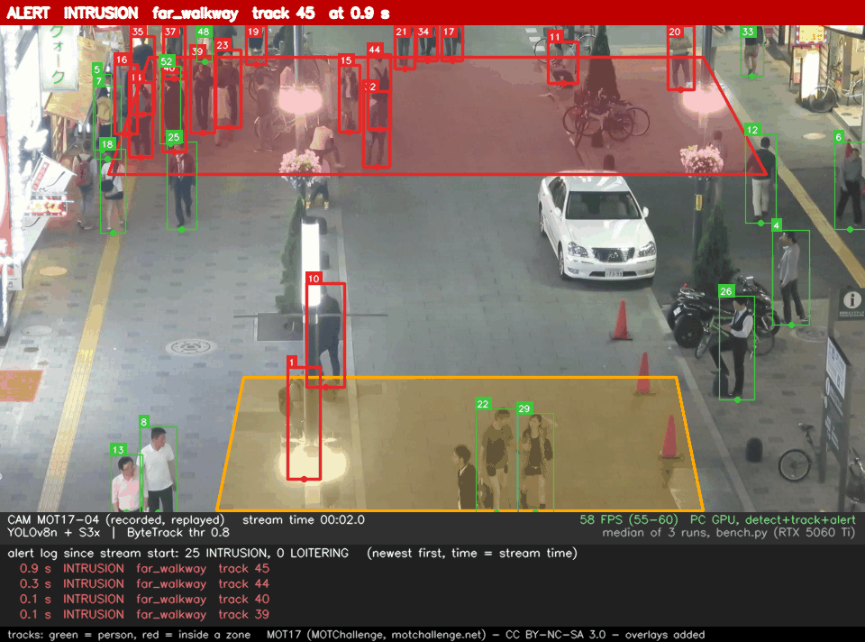
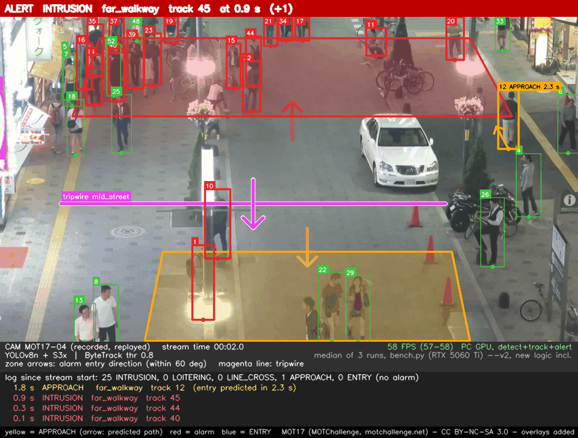
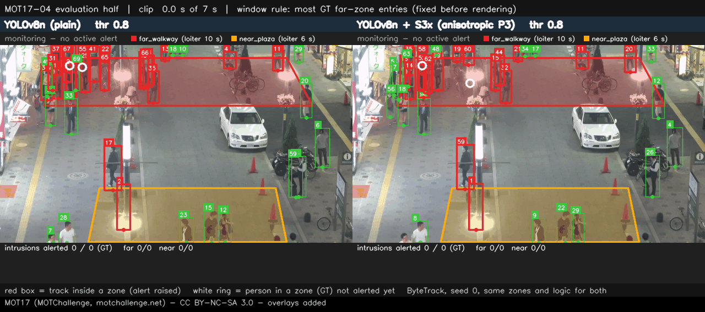

# Zone intrusion and loitering alerts on an edge pedestrian tracker

**At a glance**
- **What:** named polygons on a camera image; INTRUSION when a tracked person's foot point enters one, LOITERING after a
  dwell limit; v2 adds an APPROACH warning, a direction filter and tripwires. Runs on YOLOv8n + S3x and ByteTrack.
- **Tested on:** the MOT17-04 and MOT17-09 evaluation halves, one training seed, no confidence intervals.
- **Far-zone entries alerted:** 40 vs 39 of 48 (S3x vs plain), a tie; **false alerts** 28 vs 42; **loitering caught**
  4 vs 6 of 18.
- **v2 APPROACH warning:** not yet useful. It warns 4 (S3x) and 5 (plain) of 24 far-zone walk-ins against 10 and 11
  false warnings; all 4 warnings in the v2 demo clip are false.
- **Speed:** detect + track + alert at 56-76 FPS (medians per sequence and model) on a desktop GPU (RTX 5060 Ti);
  the Jetson end-to-end pipeline was not measured.
- **Why the gain is small here:** the people in these zones are larger than the far pedestrians where S3x helps (about
  8 px wide on the detector input, see `../../demo/dsec_clear_1.gif`).

**Responsible use.** This is a research prototype, not a security product. It does not identify anyone: there is no
re-identification model and no appearance feature. It writes events (track id, zone, time, foot point) and, when asked,
an annotated video. Before using it on real CCTV footage, check the privacy and
video-surveillance law of your country (for example notice, purpose limitation and retention rules), and validate it
on the installed camera: the numbers below come from two public sequences.

A small security/CCTV service layer that runs on the edge pedestrian tracker of this project (YOLOv8n + S3x on a 416x256
canvas, ByteTrack). You draw named polygons on the camera image. The app raises **INTRUSION** when a tracked person's foot
point enters a zone and **LOITERING** when the person stays longer than the zone's limit. Optional **ignore masks**, set at
installation, mute fixed spots that would otherwise keep alerting. Version 2 adds three optional per-zone features:
an **APPROACH** warning before a person enters a zone, a **direction filter** that alarms only for entries from a chosen
side (other entries are logged as a non-alarm **ENTRY**), and virtual **tripwires** (**LINE_CROSS**); see
[v2](#v2-approach-warning-direction-filtered-intrusion-tripwires).



*Window rule, fixed and written here before the first render: among all 8 s windows (stride 1 s) of the MOT17-04 evaluation
half, take the one with the most scored GT zone entries (GT episodes in any zone that start after the first frame and are
confirmed inside the window); on a tie, take the earliest. The rule uses ground truth only, not how the model looks.*

*Outcome: the rule chose MOT17-04 2.0-10.0 s (frames 587-826). Across the 10 candidate windows the score ranged from 8 to
13 entries, and the 2 s and 3 s windows tied at 13, so the earlier one was taken. Shown: YOLOv8n + S3x, ByteTrack thr 0.8,
seed 0, evaluation zones (no ignore masks). The alert state is replayed from the stream start, and the events equal
`compare.py`'s. Green box: tracked person. Red box: the person is inside a zone. Banner: newest alert. Grey strip below the
video (nothing is drawn over the camera image): camera, stream clock, model and the FPS badge. Bottom list: the last alerts
with stream time. The FPS badge is the measured pipeline speed of S3x on MOT17-04 on the development PC (`timing.json`: median 58,
range 55-60 FPS, detect + track + alert on an RTX 5060 Ti), not a Jetson figure. No ground truth is drawn.
In the clip the app raises 35 INTRUSION alerts and 1 LOITERING alert. The evaluation's attribution counts 9 hits,
7 duplicates (a new track id after an identity switch), 5 on real people without a scored GT episode and 14 with no matching
person (IoU < 0.5). Of the 13 GT entries in the window, 7 are alerted by the end of the clip (plain YOLOv8n: 10 of 13 on
the same window, see the appendix). The red box at the lamp post and its LOITERING alert at 6.0 s belong to a real person
standing behind the post (see "The alert at the lamp post"). MP4 (1280 x 944, H.264, 4.1 MiB):
[demo/zone_alert_service.mp4](demo/zone_alert_service.mp4). GIF: 960 x 712 px, 10 fps, 6.5 MiB; the width is the largest of
1280 / 1120 / 960 px that stays under 8 MiB (8,388,608 bytes).*
*Frames: MOT17 (https://motchallenge.net), CC BY-NC-SA 3.0 (https://creativecommons.org/licenses/by-nc-sa/3.0/);
resized and annotated with zones, tracks and alerts; shared under CC BY-NC-SA 3.0, non-commercial use only.*

**Where S3x itself helps** is shown by the project demo [`../../demo/dsec_clear_1.gif`](../../demo/dsec_clear_1.gif): two
far pedestrians on a DSEC road, about 8 x 20 px on the detector input, tracked in 14 % of their frames by plain YOLOv8n and
100 % by YOLOv8n + S3x at the same threshold. This app is the service layer on top of that detector. On MOT17 the people in
the zones are larger than that. In the comparison below, alerted entries barely change (far zones: 40 vs 39 of 48), S3x
raises fewer false alerts (28 vs 42), and plain catches more loitering (6 vs 4 of 18).

## What the app does

| stage | what | code |
|---|---|---|
| detect | YOLOv8n + S3x (or plain YOLOv8n), 416x256 letterbox, FP16, conf >= 0.01, class-wise NMS 0.65, pedestrians kept | `PedestrianDetector` |
| track | ByteTrack (BoxMOT), track threshold `--thr`, match 0.8, buffer 15 frames | `PedestrianTracker` |
| alert | foot point (bottom-centre of the box) in polygon; hysteresis K = 5 frames to enter and to exit; INTRUSION on entry, LOITERING once per stay when the dwell reaches `dwell_s`; ignore masks mute tracks standing in them | `ZoneMonitor` |

- **Why K = 5.** At 30 fps a 167 ms hysteresis absorbs box jitter at a zone edge, and a real entry is still alerted within a fifth
  of a second. A track the tracker stops reporting keeps its zone state for 15 frames, the tracker's own buffer, and then the stay
  is closed.
- **Dwell is wall-clock time** from the first of the K inside frames. LOITERING can therefore fire on a frame where the foot is
  already outside again (during the 5-frame exit delay) or on the first report after a gap.
- **Ignore masks.** A foot point inside any ignore polygon counts as *outside every zone* on that frame, before the zone
  hysteresis. A track standing on a mask therefore never gets K inside frames in a row and raises no INTRUSION or LOITERING. An
  alerted track that settles on a mask is closed by the normal EXIT after K frames. A box whose foot point jitters across the mask
  edge cannot build up an entry either, also for a new track id after an identity switch, because its in-zone frames are never K
  in a row. A track that leaves the mask into a zone raises INTRUSION on its K-th frame inside, like any other track. A track
  that only crosses the mask for fewer than K frames keeps its stay. A track with its foot point in a mask for K frames in a row
  is drawn faint grey with the label `masked` (it is still tracked); this flag is only for drawing, so a box jittering across
  the mask edge may still be drawn as a normal green box, but it raises no alert.
  A zone file without `ignore` gives exactly the events of the unmasked app: on all 4 stored runs (2 sequences x 2 models)
  every event matches the stored one in every field, and the same holds with a non-empty mask that no foot point reaches
  (`tests/test_zone_monitor.py`, `test_cached_runs_unchanged_without_ignore`, `test_cached_runs_unchanged_with_a_mask_no_foot_reaches`).
- **Same as the benchmark.** Detection and tracking are the benchmark's own export and tracker code (`efpmot.models`,
  `efpmot.track.make_tracker`). On every evaluation frame of both sequences, the app's tracks equal the benchmark tracker
  outputs (`scripts/track.py`) in every column (id, x, y, w, h, confidence) up to the rounding of the stored file
  (`results.md`, "Same tracks as the benchmark").
- **What comes from `efpmot`.** `zone_alert.py` imports the model builder (`efpmot.models.build`), the letterbox
  (`efpmot.data.letterbox`) and the tracker factory (`efpmot.track.make_tracker`). The evaluation scripts also use
  `efpmot.data.mot17` (frame lists, half split) and `efpmot.eval.protocol` (cross-fitted thresholds, read from
  `results/stats`). Everything else is in this folder.

## Requirements and data

- The package requirements of the repository (`pip install -e .` from the repository root; tested with Python 3.10,
  torch 2.8, ultralytics 8.3.170, boxmot 25.0, opencv-python 4.11).
- **Not included:** the MOT17 data (see [`docs/DATA.md`](../../docs/DATA.md); the app reads
  `<mot17_train>/MOT17-XX-FRCNN/img1`, the evaluation reads `<mot17_train>/MOT17-XX-FRCNN/gt/gt.txt`, where
  `<mot17_train>` is `data.mot17_train` of `configs/paths.yaml`) and the checkpoints. Use the MOT17 release files
  `release_assets/yolov8n_plain_mot17_416x256_s0.pt` and `release_assets/yolov8n_s3x_mot17_416x256_s0.pt` (GitHub Releases), or your own
  `<runs>/<name>/last.pth`; `compare.py` and `bench.py` take `<runs>/<name>/last.pth` when it exists, else the release file.
- `compare.py` checks the app's tracks against the benchmark tracker outputs in `<results>/mot17_trackers/`, so run the
  benchmark pipeline for the two seed-0 MOT17 runs first ([`docs/REPRODUCE.md`](../../docs/REPRODUCE.md)).
- `cache/` and `out/` are generated here and git-ignored.

## Run

From the repository root. `<mot17_train>` stands for your `data.mot17_train` folder.

```bash
# 1. the app (MOT17-04 evaluation half = frames 527..1050; MOT17-09: 264..525)
python -B apps/zone_alert/zone_alert.py --frames <mot17_train>/MOT17-04-FRCNN/img1 --start 527 --stop 1050 \
    --family yolov8n_s3x --weights release_assets/yolov8n_s3x_mot17_416x256_s0.pt --hw 256 416 \
    --zones apps/zone_alert/zones/MOT17-04.json --thr 0.8 --out apps/zone_alert/out/MOT17-04_s3x.mp4
#    plain model: --family yolov8n --weights release_assets/yolov8n_plain_mot17_416x256_s0.pt ; a video file: --video FILE
#    --device cpu runs without a GPU (FP32, slower; the published timings are FP16 on a desktop GPU)
#    writes out/MOT17-04_s3x.mp4 and out/MOT17-04_s3x.events.jsonl, prints FPS and per-stage times
#    ignore masks are read from the same zone file (top-level "ignore" list), if it has one

# 2. zone layout picture only (zones and ignore masks on the first frame)
python -B apps/zone_alert/zone_alert.py --frames <mot17_train>/MOT17-04-FRCNN/img1 --start 527 \
    --zones apps/zone_alert/zones/MOT17-04.json --layout apps/zone_alert/zones/MOT17-04.png

# 3. offline comparison against the GT (both models, MOT17-04 + MOT17-09) -> results.md, results.json, cache/
python -B apps/zone_alert/compare.py            # add --reuse to skip the GPU runs and reuse cache/

# 4. service demo, single panel, S3x (needs steps 3 and 5) -> demo/zone_alert_service.gif / .mp4, demo/service_log.json
python -B apps/zone_alert/render_service.py     # --zones FILE to render with another zone file (e.g. with masks)

# 5. timing: 3 app runs per sequence and model -> timing.md, timing.json (and the annotated videos in out/)
python -B apps/zone_alert/bench.py

# 6. appendix: side-by-side plain vs S3x demo (needs step 3) -> demo/zone_alert_compare.gif / .mp4
python -B apps/zone_alert/render_demo.py

# 7. tests: alert logic incl. ignore masks and the v2 features (no GPU, no data) + replay of the cached runs
#    (skipped without cache/)
python -B apps/zone_alert/tests/test_zone_monitor.py

# 8. v2: held-out choice of the APPROACH fit-residual cut on MOT17-02 (stored benchmark tracks, no GPU)
#    -> calibration_v2.json (its value is MAX_RESIDUAL in zone_alert.py)
python -B apps/zone_alert/calibrate_v2.py
#    v2: evaluation of APPROACH / direction filter / tripwires (needs step 3) -> results_v2.md, results_v2.json
python -B apps/zone_alert/compare_v2.py
# 9. v2: timing, v1 and v2 zone files interleaved -> timing_v2.md, timing_v2.json (timing.md is not touched)
python -B apps/zone_alert/bench.py --v2
# 10. v2: service demo (needs steps 3, 8 and 9) -> demo/zone_alert_service_v2.gif / .mp4, demo/service_log_v2.json
python -B apps/zone_alert/render_service.py --v2
#     the app itself takes a v2 zone file like any other: --zones apps/zone_alert/zones/MOT17-04_v2.json
```

Each line of `events.jsonl` looks like this:
`{"type": "INTRUSION", "zone": "far_walkway", "track_id": 45, "frame": 553, "t": 0.867, "entered": 549, "foot": [436.1, 309.5]}`.
EXIT events are also logged. Events of the v2 features carry two more fields, `velocity` (body heights per second, image
x and y) and `eta_s` (APPROACH: predicted seconds until the foot point enters), e.g.
`{"type": "APPROACH", "zone": "far_walkway", "track_id": 12, "frame": 582, "t": 1.833, "entered": 578, "foot": [1686.9, 441.7], "velocity": [-0.141, -0.242], "eta_s": 2.31}`.

| file | what |
|---|---|
| `zone_alert.py` | the app: detector, tracker, `ZoneMonitor` (zones + ignore masks + v2 motion features: `fit_motion`, `time_to_enter`, `ApproachRule`, `DirectionRule`, `Tripwire`), drawing, CLI |
| `compare.py` | GT episodes, alert attribution and summaries; writes `results.json` |
| `compare_v2.py` | v2 evaluation (APPROACH, direction filter, tripwires) on the cached tracks; writes `results_v2.json` / `.md` |
| `report.py` | writes `results.md` from the results |
| `render_service.py` | window rule and the single-panel S3x service GIF / MP4 (`--v2`: the v2 demo) |
| `render_demo.py` | window rule and the side-by-side plain vs S3x GIF / MP4 (appendix) |
| `bench.py` | timing over repeated runs (`--v2`: v1 vs v2 zone files) |
| `replay_dets.py` | replays a benchmark detection cache (`scripts/export_dets.py`) through the tracker and zone logic, without the detector or a GPU; `--expect` compares the events with a stored run |
| `calibrate_v2.py` | held-out choice of the APPROACH fit-residual cut on MOT17-02; writes `calibration_v2.json` |
| `tests/test_zone_monitor.py` | 43 synthetic tests (alert state machine, ignore masks incl. mask-edge jitter, APPROACH incl. box jumps, re-arming and drawing hold, direction filter, tripwires incl. starting side and segment ends, banner priority) and 3 replay tests of the cached runs |

## Zone file

```json
{
  "sequence": "MOT17-04-FRCNN",
  "zones": [
    {"name": "far_walkway", "kind": "far", "polygon": [[330, 70], [1560, 70], [1700, 330], [240, 330]],
     "dwell_s": 10.0, "note": "why this polygon"}
  ],
  "ignore": [
    {"name": "flag_pole", "polygon": [[900, 500], [940, 500], [940, 620], [900, 620]],
     "note": "who added it, when, and after which false alarm"}
  ]
}
```

- Polygons use source-image pixels. `dwell_s` is the loitering limit in seconds.
- The v2 keys (`approach`, `alarm_direction` / `alarm_edge`, `min_cos`, top-level `lines`) are described in
  [v2 / Configuration](#configuration); a file without them behaves exactly as above.
- `kind` and `note` are free text. The evaluation uses `kind` to pool far and near zones.
- `ignore` is optional. Each entry needs a `polygon` and a non-empty `note` saying why the mask exists (the loader refuses a
  mask without one), and it can have a `name` (default `ignore_<i>`). Masks are an installation-time setting, as in CCTV products. Keep each mask tight around the fixed
  object and check on recorded footage that no walking person's foot point falls inside it. The ignore polygon above is a schema
  example, not a mask used anywhere.
- The zones in `zones/` were drawn from scene geometry on the first evaluation frame, before any model output was looked at.
  The polygons were not changed afterwards. Each zone's reason is in its `note`. One note was wrong about the scene and has a
  `noted_afterwards` correction (MOT17-04 `near_plaza`: the polygon contains the lamp post and the cones, and people there are a
  median 261 px tall, not 300-400 px). Layout pictures: [MOT17-04](zones/MOT17-04.png), [MOT17-09](zones/MOT17-09.png).

<details>
<summary>The alert at the lamp post is a real person, so no mask was added</summary>

Both models keep one track at the lamp post inside the MOT17-04 near zone for the whole evaluation half (S3x track 1,
plain track 2). It raises an INTRUSION at 0.13 s and a LOITERING at 6.0 s. It looked like a lamp post detected as a person,
and the plan was to mute it with an ignore mask. A check before writing the mask showed a real person with a backpack
standing behind the post for the whole sequence. MOT17 annotates this person as a pedestrian (GT id 6, class 1, about 26 %
visible, annotated on all 1050 frames). The track box matches this GT box (639, 757, 709, 1007 px), and the evaluation already
counts these alerts as *unscored* (a real person, too hidden to score), not as false alerts.

Any mask tight enough to mute this track, for example `[[655, 965], [700, 965], [700, 1050], [655, 1050]]` around the base of
the post, contains this person's GT foot point on 524 of 524 evaluation frames. Replaying the cached tracks with that mask
removes exactly two alerts (INTRUSION and LOITERING of that track, for either model) and changes nothing else, so the mask
would only mute a real person. No lamp-post mask was therefore added: there is no `zones/MOT17-04_demo.json`, and the service
demo runs on the evaluation zones. The ignore-mask feature stays in the app for real fixed false alarms (posters,
mannequins, reflections), set at installation as described above.

</details>

## Plain YOLOv8n vs YOLOv8n + S3x (from [results.md](results.md))

The test data are the evaluation halves of MOT17-04 and MOT17-09; the detectors were trained on the first halves. Both models
use ByteTrack, seed 0, and a per-sequence threshold chosen by leave-one-sequence-out cross-fitting (0.8 for both). The zone files
are the evaluation ones (no ignore masks).

- **GT intrusion episode:** a GT pedestrian's foot point stays in a zone for at least K frames, using every annotated frame
  whatever the visibility. GT runs through the same monitor as the app. An episode is scored when the person is at least 50 %
  visible inside the zone on at least K frames; people hidden for their whole stay are not scored.
- **Hit:** the model raised INTRUSION for a track matched to that person (IoU >= 0.5) on one of the 5 frames up to the alert.
- **Delay:** model alert frame minus the frame where the GT foot point confirms the entry. It includes time a person spends
  hidden after entering. A negative delay means the model's foot point crossed into the zone before the GT foot point did; this
  is the case for all 16 negative delays.
- **False alert:** on those 5 frames, the alert's track matches a GT person outside the zone, a MOT17 'distractor' or
  'reflection' box, or nothing. Alerts on real people without a scored episode, including MOT17 'static person' boxes, are
  unscored (neither hit nor false).
- **Duplicate:** another alert for a person who was already alerted, almost always from a new track id after an identity switch
  (59 of 62).

| zone (both sequences) | model | GT episodes | alerted | median delay | p90 delay | false alerts | duplicates | loitering hit / GT | false loitering |
|---|---|---|---|---|---|---|---|---|---|
| far  | plain | 48 | 39 | 0.00 s | 1.93 s | 42 | 28 | 6 / 18 | 2 |
| far  | S3x   | 48 | 40 | 0.00 s | 2.06 s | 28 | 30 | 4 / 18 | 2 |
| near | plain | 13 | 11 | 0.00 s | 0.00 s | 1 | 1 | 0 / 1 | 0 |
| near | S3x   | 13 | 12 | 0.00 s | 0.00 s | 0 | 3 | 0 / 1 | 0 |

- **Far-zone intrusions: a tie.** S3x alerted 40 of 48 episodes and plain 39. Per sequence: on MOT17-04, plain 28 vs S3x 27 of
  33; on MOT17-09, plain 11 vs S3x 13 of 15. One episode is not evidence either way.
- **Fewer false alerts with S3x.** In the far zones S3x has 28 false alerts and plain 42. Duplicates (30 vs 28) and false
  loitering (2 vs 2) are about the same.
- **Loitering: plain caught more.** Plain alerted 6 and S3x 4 of the 18 far-zone GT loitering episodes. Both miss most of
  them. The loitering rule does not join stays across an identity switch (see Limitations).
- **Why no recall gain here.** The far-zone people on MOT17-04 are a median 160 px tall in 1080p, about 35 px on the 416x256
  detector input (MOT17-09: 289 px, about 63 px). That is above the size range where S3x helps; its clear gains are on people
  about 20 px tall and 8 px wide on the input, as in the DSEC clip above.
- **Episodes that start during the clip** (not people already standing in a zone at the first frame; 24 of these 26 far-zone
  episodes are walk-ins and 2 start where the person's annotation begins inside the zone): plain 18 and S3x 19 of 26.
- **Most strict false alerts are loose boxes.** Of the 64 'no person' false alerts (both models, all zones), 54 overlap a real
  person at IoU 0.2-0.5. A post-hoc sensitivity check matched at IoU >= 0.3 instead: far zones then give 44 vs 43 alerted and
  9 vs 19 false (S3x vs plain).
- **Delay.** The median is 0 s for both models; the far-zone p90 is 2.06 s (S3x) and 1.93 s (plain).
- **Near zones (control).** S3x alerts 12 and plain 11 of 13 episodes; plain has one false alert.
- **Rule changes.** A first version of this evaluation used looser rules (a hit could be credited to the wrong person, static
  people counted as false alerts, GT episodes only from frames with visibility >= 0.5). It reported 38 vs 39 of 47 alerted,
  24 vs 21 false alerts and 47 vs 37 duplicates (plain vs S3x). The "S3x has fewer duplicates" finding of that version did not
  hold up.

## Speed on a desktop GPU (RTX 5060 Ti; from [timing.md](timing.md))

Median of 3 app runs, with the range in brackets. The first 10 frames of each run are excluded.

| sequence | model | detect | track | alert logic | pipeline FPS (detect+track+alert) | end-to-end FPS (+ JPEG decode, drawing, H.264) |
|---|---|---|---|---|---|---|
| MOT17-04 (crowded) | plain | 11.5 ms | 6.0 ms | 0.21 ms | 56 (56-60) | 36 (36-37) |
| MOT17-04 (crowded) | S3x | 11.3 ms | 5.8 ms | 0.20 ms | 58 (55-60) | 36 (36-38) |
| MOT17-09 | plain | 11.1 ms | 2.0 ms | 0.06 ms | 76 (71-78) | 45 (44-46) |
| MOT17-09 | S3x | 11.3 ms | 1.9 ms | 0.06 ms | 75 (68-78) | 44 (42-45) |

- **Detect** covers letterboxing the 1080p frame, the FP16 forward pass, NMS and the copies to and from the GPU. Plain and S3x run
  at the same speed within run-to-run noise.
- **Run-to-run noise is large.** Within one session the runs vary by up to about 14 %; an independent rerun in another session
  measured 68 FPS (pipeline) and 41 FPS (end-to-end) for S3x on MOT17-04, 13-18 % above these medians. Quote ranges, not single values.
- **Track** time grows with the crowd: BoxMOT's ByteTrack is pure Python.
- **The zone logic is negligible**, about 0.2 ms per frame or less.
- These timings were measured before the ignore masks were added. With no `ignore` list, the per-track mask check is skipped.

## v2: approach warning, direction-filtered intrusion, tripwires



*Same window rule as the v1 demo above, applied to the same `results.json`, so the same clip: MOT17-04 2.0-10.0 s
(frames 587-826). Shown: YOLOv8n + S3x, ByteTrack thr 0.8, seed 0, `zones/MOT17-04_v2.json`; the state is replayed from
the stream start. No ground truth is drawn. Faint arrows on the zones: alarm direction of entry (within 60 degrees);
magenta line: the tripwire (arrow = alarm direction). Yellow box with an arrow and `APPROACH n s`: a raised APPROACH
warning while its condition holds (and 0.3 s after), n counted down; the arrow shows at most the next 1.5 s of the
predicted foot path. Red: inside a zone with an alarm. Blue: inside after a non-alarm ENTRY (log only, no banner). The
banner is red while any alarm is recent and amber only for warnings alone. In the clip the app raises 4 APPROACH,
26 INTRUSION, 9 ENTRY, 1 LOITERING and 1 LINE_CROSS events; the 26 + 9 entries are exactly the 35 INTRUSION alerts of
the v1 clip, split by the direction filter.*

*Outcome (from `compare_v2.py`'s evaluation, listed in `demo/service_log_v2.json`): **all 4 APPROACH warnings raised in
the clip are false.** Tracks 56 (3.3 s) and 18 (5.5 s) are real people (GT 69 and 68) who stop short of `far_walkway`;
track 94 (9.0 s for `far_walkway`, 9.8 s for `near_plaza`) is a box that switches between a person sitting by the
planter (a MOT17 'static person') and the person standing behind, so its foot point jumps. The one correct warning
nearby, track 12 (raised at 1.8 s, 0.2 s before the clip; the person entered 3.5 s later), is shown counting down
until 3.4 s. Without the direction filter the window would also hold two correct warnings (tracks 67 and 59 stepping into
`near_plaza` sideways); they are not alarm-direction approaches, so the configured filter drops them by design. The FPS
badge is the v2 row of `timing_v2.json` (S3x, MOT17-04, the new logic included: median 58, range 57-58 FPS, RTX
5060 Ti). MP4 (1280 x 968, H.264, 4.3 MiB): [demo/zone_alert_service_v2.mp4](demo/zone_alert_service_v2.mp4). GIF:
960 x 728 px, 10 fps, 6.7 MiB (the largest of 1280 / 1120 / 960 px under 8 MiB). The v1 files are kept.*
*Frames: MOT17 (https://motchallenge.net), CC BY-NC-SA 3.0 (https://creativecommons.org/licenses/by-nc-sa/3.0/);
resized and annotated with zones, tracks and alerts; shared under CC BY-NC-SA 3.0, non-commercial use only.*

All three features are optional and set per zone (or per file for tripwires). A zone file without the new keys switches
the motion code off and gives exactly the v1 events.

| event | when | shown as |
|---|---|---|
| **APPROACH** (warning) | the person's straight extrapolated foot path enters the zone within `horizon_s`, at a speed of at least `min_speed`, on a clean line fit, for k frames in a row; once per track and zone | yellow box, arrow along the predicted path and `APPROACH 2.1 s` (counted down) while the condition holds and 0.3 s after; amber banner |
| **INTRUSION** (alarm) | as v1; with a direction filter only when the motion at the entry points in the alarm direction | red box, red banner |
| **ENTRY** (log only) | an entry that the direction filter rejects; the stay can still raise LOITERING | blue box, listed in the log, no banner |
| **LINE_CROSS** (alarm) | the foot point crosses a tripwire in its alarm direction | red banner |

The banner is red whenever an alarm is among the alerts of the last 1.5 s, even if an APPROACH warning is newer; it is
amber only when warnings alone are recent.

<details>
<summary>v2 details: how it works, configuration, chosen directions, evaluation and timing</summary>

### How it works

- **Velocity.** A least-squares line through the track's foot points of the last 0.8 s (24 frames at 30 fps; at least
  13 observations) gives a smoothed foot point, a velocity and the RMS residual of the fit, all from one pass of running
  sums. One line over 24 frames averages box jitter: 3 px of per-frame jitter leaves about 2.65 px/s of velocity error
  (`fit_motion`).
- **Speed without calibration.** The velocity in pixels per second is divided by the track's median box height, giving
  **body heights per second** (BH/s), so near and far people are compared on one scale without a camera calibration.
  Brisk walking across the image is about 0.8 BH/s (1.4 m/s for a 1.7 m person), but the people in these clips are much
  slower: in the MOT17-04 far band, GT movers have a median of 0.25 BH/s when they move sideways (which foreshortening does
  not affect) and 0.17 BH/s along the viewing direction; MOT17-02 movers 0.26 BH/s, MOT17-09 0.44 BH/s. Box height changes
  little with depth in MOT17-04 (about 158 px at image row 200, 221 px at row 700), so the camera looks steeply down and
  foreshortening is mild: these people stroll. **The speed threshold (`min_speed`, default 0.25 BH/s) is therefore
  scene-dependent**; in MOT17-04 it is the median moving person, not a "standing still" level. Below it a track has no
  direction. A ground homography would turn BH/s into m/s; it is not implemented.
- **APPROACH.** The track is outside the zone (raw and fitted foot point), its speed is at least `min_speed`, the line fits
  the recent foot points (RMS residual at most `max_residual` = 0.075 body heights, so a box that jumps does not
  extrapolate), and the ray from the fitted foot point along the velocity hits a polygon edge within `horizon_s` seconds
  (`time_to_enter`, exact ray-edge intersection). When this holds for `k` observed frames in a row, one APPROACH is raised
  with the predicted time to entry (`eta_s`). The warning re-arms after 1 s without the condition **and** after the person
  has moved half a body height farther from the zone than the closest point since the warning (so standing or milling at
  the edge is not re-warned), or after the stay's EXIT. With a direction filter on the zone, APPROACH is raised only for
  motion in the alarm direction.
- **Residual cut from held-out data.** `calibrate_v2.py` fixed its rule before it was run: on the MOT17-02 evaluation half
  (not used for training, for the evaluation or for any other setting), take the 99th percentile of the residual over
  observations of correctly tracked movers (both models' stored tracks), rounded up: 0.075 (`calibration_v2.json`). A cut
  read off this evaluation's own warnings would have been about 0.035.
- **Direction filter.** At the entry (the K-th frame inside, as in v1) the velocity of the last 0.8 s, i.e. mostly the
  steps before the crossing, is compared with the alarm direction: within `min_cos` (default 60 degrees) gives INTRUSION,
  otherwise ENTRY. When the direction is unknown (track younger than 0.4 s, or slower than `min_speed`) the entry is an
  INTRUSION (fail-safe). The filter only labels entries; it never changes when a stay starts, ends or loiters.
- **Tripwire.** A segment with an alarm direction. A side of the line, the starting side included, is confirmed after
  K = 5 frames on it (the same hysteresis as the zones), so a track first seen a few pixels on the wrong side cannot cross
  on its second frame. K frames beyond the segment's ends forget the side, so walking around an end is no crossing; the
  ends are extended by a quarter of the person's box height so that a foot passing just beside an end still counts. A
  confirmed change toward the alarm side raises LINE_CROSS; the other way raises nothing. Ignore masks do not apply to
  tripwires.
- **Old zone files are unchanged.** On all 4 stored runs the v1 zone files replay to the stored events in every field
  (`test_cached_runs_unchanged_without_ignore`), and the v2 zone files give the same events once APPROACH / LINE_CROSS
  are dropped and ENTRY is read as INTRUSION (`test_v2_zone_files_only_add_events_or_relabel_entries`; `compare_v2.py`
  checks the same). `ZoneMonitor.update` refuses to run APPROACH or a direction filter without box heights instead of
  silently switching them off.

### Configuration

```json
{
  "zones": [
    {"name": "far_walkway", "kind": "far", "polygon": [[330, 70], [1560, 70], [1700, 330], [240, 330]], "dwell_s": 10.0,
     "approach": {"horizon_s": 3.0, "min_speed": 0.25, "k": 5, "max_residual": 0.075},
     "alarm_direction": [0, -1], "min_cos": 0.5,
     "direction_note": "why this direction"}
  ],
  "lines": [
    {"name": "mid_street", "points": [[200, 620], [1480, 620]], "alarm_direction": [0, 1], "note": "why this line"}
  ]
}
```

- `approach`: `true` for the defaults or an object; `horizon_s` [s], `min_speed` [body heights / s], `k` [frames],
  `max_residual` [body heights, `null` = no check]. Set `min_speed` for the scene (see above).
- Direction: `alarm_direction` `[dx, dy]` in image axes (y points down), or `alarm_edge: i` = crossing polygon edge
  i (vertex i to i+1) inward; `min_cos` (default 0.5, i.e. within 60 degrees).
- `lines`: two points, an `alarm_direction` that must not be parallel to the line, and a required `note`.

### Chosen directions and tripwires

They were chosen from the scene geometry of the first evaluation frame, before any output of the new logic (model or
GT) was looked at, and written to copies of the evaluation zone files: [`zones/MOT17-04_v2.json`](zones/MOT17-04_v2.json),
[`zones/MOT17-09_v2.json`](zones/MOT17-09_v2.json) (polygons, dwell limits and notes unchanged; the originals are
untouched). Layout pictures with arrows: [MOT17-04](zones/MOT17-04_v2.png), [MOT17-09](zones/MOT17-09_v2.png).

| sequence | zone / line | alarm when | logged as ENTRY / ignored |
|---|---|---|---|
| MOT17-04 | `far_walkway` | walking into the far end of the street from the camera side: across its near edge, moving up the image (away from the camera) | coming out of the far end, stepping in from the shop fronts or the kerb |
| MOT17-04 | `near_plaza` | coming down the street toward the camera across its far edge (`alarm_edge` 0) | stepping in from the left pavement or the cones side |
| MOT17-04 | tripwire `mid_street` (row 620, x 200-1480) | crossing the whole street at mid depth toward the camera | crossing away from the camera |
| MOT17-09 | `far_storefront` | turning off the pavement toward the far shop entrance, across its front edge (`alarm_edge` 2, moving up) | walking along the pavement into or through the strip |
| MOT17-09 | `near_entrance` | walking from the pavement straight toward the near shop door, across its front edge (`alarm_edge` 2) | passers-by stepping in from the left or right |
| MOT17-09 | tripwire `pavement` (column 1250, rows 745-1075) | walking right, deeper along the pavement toward the far entrance | walking left, toward the camera side |

### Evaluation (from [results_v2.md](results_v2.md))

`compare_v2.py` replays the cached tracks of both models through the v2 zone files and runs the same logic on the GT
trajectories. The episodes and the visibility rules are those of `compare.py`. A **walk-in** is a scored GT episode of a
person seen outside the zone before. An APPROACH **hits** a walk-in when its track is matched to that person (IoU >= 0.5)
and the GT foot point enters later, at most horizon + 1 s after the warning; **lead** = GT entry time - warning time. A
hit 0.03 s before the entry helps nobody, so the tables also count hits with a lead of at least 0.5 s. A **false**
warning is one whose person does not enter within horizon + 1 s, or one on a track matched to no person. Warnings in the
last horizon + 1 s of a clip are not judged (**censored**; this rule was added after a first run showed that most of the
GT oracle's "false" warnings were there). The **GT oracle** is the same rule on the GT trajectories, i.e. with perfect
tracks. Tables: direction filter off, so every walk-in is a target.

| zone | source | walk-ins | warned before entry | of these lead >= 0.5 s | median lead (range) | warnings | false (no entry / no person) | censored |
|---|---|---|---|---|---|---|---|---|
| far | GT oracle | 24 | 11 (46 %) | 7 | 1.00 s (0.03-2.97) | 26 | 2 (2 / 0) | 7 |
| far | plain | 24 | 5 (21 %) | 4 | 1.87 s (0.20-3.63) | 23 | 11 (3 / 8) | 4 |
| far | S3x | 24 | 4 (17 %) | 3 | 2.33 s (0.03-3.53) | 19 | 10 (2 / 8) | 3 |
| near | GT oracle | 8 | 6 (75 %) | 3 | 0.73 s (0.03-1.47) | 8 | 1 (1 / 0) | 1 |
| near | plain | 8 | 4 (50 %) | 1 | 0.30 s (0.10-0.60) | 7 | 2 (1 / 1) | 1 |
| near | S3x | 8 | 4 (50 %) | 3 | 0.90 s (0.13-1.67) | 5 | 1 (0 / 1) | 0 |

Far zones per sequence (the MOT17-04 far zone is the small-person one):

| sequence | source | walk-ins | warned before entry | lead >= 0.5 s | false (no entry / no person) |
|---|---|---|---|---|---|
| MOT17-04 | GT oracle | 15 | 4 | 1 | 2 (2 / 0) |
| MOT17-04 | plain | 15 | 1 | 1 | 11 (3 / 8) |
| MOT17-04 | S3x | 15 | 1 | 1 | 10 (2 / 8) |
| MOT17-09 | GT oracle | 9 | 7 | 6 | 0 (0 / 0) |
| MOT17-09 | plain | 9 | 4 | 3 | 0 (0 / 0) |
| MOT17-09 | S3x | 9 | 3 | 2 | 0 (0 / 0) |

| direction filter (walk-ins) | model | with a model decision | agrees with the GT-trajectory decision | GT alarm -> ENTRY | GT ENTRY -> alarm (fail-safe) |
|---|---|---|---|---|---|
| far | plain | 16 of 24 | 12 (75 %) | 0 | 4 (3) |
| far | S3x | 18 of 24 | 12 (67 %) | 0 | 6 (4) |
| near | plain | 7 of 8 | 7 (100 %) | 0 | 0 (0) |
| near | S3x | 8 of 8 | 7 (88 %) | 0 | 1 (1) |

| tripwire | model | scored GT crossings | detected | median delay | false |
|---|---|---|---|---|---|
| MOT17-04 `mid_street` | plain / S3x | 3 | 3 / 3 | -0.03 s / -0.07 s | 0 / 0 |
| MOT17-09 `pavement` | plain / S3x | 4 | 3 / 4 | 0.03 s / 0.02 s | 0 / 0 |

- **The speed threshold limits the rule; the tracks limit the models.** On clean GT paths the rule warns 4 of 15
  walk-ins in the MOT17-04 far zone, the small-person zone, and 7 of 9 in the MOT17-09 one (11 of 24 pooled, 7 of them at
  least 0.5 s ahead). In MOT17-04 most of the misses are people heading in more slowly than 0.25 BH/s, and 4 of all 32
  walk-ins are seen less than 17 frames before they enter, too briefly for any source (0.4 s to get a velocity plus k = 5
  frames). On the models' tracks the rule warns 5 (plain) and 4 (S3x) of the 24 far-zone walk-ins, 4 and 3 of them at
  least 0.5 s ahead, against 11 and 10 false warnings.
- **Lowering the threshold does not rescue the models.** A post-hoc check on this same data (direction filter off,
  far zones, warned / false): `min_speed` 0.25 gives the GT oracle 11 / 2, plain 5 / 11 and S3x 4 / 10; 0.10 gives
  16 / 6, 6 / 12 and 6 / 11. The oracle gains, the models barely move. Values tried on the evaluation data are not
  evidence; a new threshold would have to be chosen on held-out footage (all variants: `results_v2.md`).
- **False warnings.** 18 of the models' warnings (both models, all zones) are on tracks matched to no GT pedestrian at
  IoU >= 0.5. 14 of them overlap a pedestrian loosely (IoU 0.2-0.5), the same loose-box cause as most v1 false alerts.
  2 are a box switching between people: S3x track 94 (in the demo) alternates between a person sitting by a planter
  (a MOT17 'static person') and the person standing behind, so its foot point jumps about 55 px for half a second. The
  held-out residual cut (0.075) removes 2 (plain) and 1 (S3x) far-zone false warnings and no hit, but not track 94,
  whose switched box fills most of the fit window.
- **Lead times are short.** Median 1.9-2.3 s in the far zones and 0.3-0.9 s in the near zones for the models; the GT
  oracle 1.00 s and 0.73 s.
- **The direction filter never suppressed an alarm the GT rule would raise** (GT alarm -> ENTRY is 0). Its disagreements
  are extra alarms: 11 walk-ins (both models) that the GT trajectory labels ENTRY, 8 of them fail-safe alarms of tracks
  too young or too slow at the entry for a direction.
- **Few true approaches in the alarm direction.** None of the 32 walk-ins entered a zone in its alarm direction at a
  measurable speed: the 15 GT INTRUSION labels all come from the fail-safe. MOT17 pedestrians mostly walk along the street
  or pavement (in the MOT17-09 far zone every walk-in with a measured direction moves right, along the pavement). The
  direction-gated APPROACH table in `results_v2.md` therefore has almost no targets and says little.
- **Tripwires.** MOT17-04: both models detect all 3 scored crossings. MOT17-09: 4 scored crossings; S3x detects 4, plain
  3 (its fourth LINE_CROSS is attributed to a hidden person crossing beside the scored one). No false crossings: the one
  of the first version (plain track 2, first seen 3 px on the wrong side of the line, "crossing" on its second frame) is
  gone with the K-frame starting side. The end margin changes which GT crossings count (MOT17-09: 4 scored instead of 3)
  and was chosen after the first version of the end rule missed one true crossing per model. Seven crossings are far
  too few to estimate a rate.

### Speed with the v2 logic (from [timing_v2.md](timing_v2.md))

`bench.py --v2`: the v1 and v2 zone files in one session, 3 runs each, interleaved; median (range). The motion
logic adds about 0.9 ms per frame on the crowded MOT17-04 (36 tracks per frame on average, 2 zones, 1 tripwire) and
0.2 ms on MOT17-09 (6 tracks). The pipeline FPS of v2 is 2-4 FPS below v1 in this session, about the size of the
run-to-run ranges. Measured with the final alert logic (residual check, re-arming rule, tripwire rules).

| sequence | model | zones | detect | track | alert logic | pipeline FPS | end-to-end FPS |
|---|---|---|---|---|---|---|---|
| MOT17-04 | plain | v1 | 11.0 ms | 5.8 ms | 0.23 ms | 59 (55-62) | 38 (35-40) |
| MOT17-04 | plain | v2 | 10.6 ms | 5.7 ms | 1.15 ms | 57 (53-58) | 37 (35-37) |
| MOT17-04 | S3x | v1 | 10.5 ms | 5.6 ms | 0.22 ms | 61 (58-61) | 39 (38-40) |
| MOT17-04 | S3x | v2 | 10.6 ms | 5.7 ms | 1.16 ms | 58 (57-58) | 37 (37-38) |
| MOT17-09 | plain | v1 | 10.3 ms | 1.8 ms | 0.07 ms | 82 (69-83) | 49 (43-49) |
| MOT17-09 | plain | v2 | 10.6 ms | 1.9 ms | 0.27 ms | 78 (78-82) | 47 (47-48) |
| MOT17-09 | S3x | v1 | 10.5 ms | 1.8 ms | 0.06 ms | 81 (81-82) | 49 (46-49) |
| MOT17-09 | S3x | v2 | 10.8 ms | 1.9 ms | 0.27 ms | 77 (74-82) | 45 (45-48) |

The v1 rows of this session are not the numbers of `timing.md` above (another session); compare v1 and v2 within this table only.

</details>

## Appendix: side-by-side clip (plain vs S3x)



*Left: plain YOLOv8n. Right: YOLOv8n + S3x. Shown: MOT17-04, evaluation half, 3.0-10.0 s (frames 617-826). A rule fixed
before the first render picks the window: the 7 s window with the most ground-truth (GT) far-zone episodes that start during
the clip (tie: the earliest). After the GT episode definition was corrected, the same rule was applied again and chose this
window (10 such episodes; no other window has more than 8). Red box: the track is inside a zone. White ring: a GT person is
in a zone and this model has not alerted yet. The counter ends at plain 10 / 13 (far 7 / 10) and S3x 7 / 13 (far 4 / 10):
**in this rule-chosen clip the plain model alerts more far people.** Over both full sequences the far-zone count is a tie
(39 vs 40 of 48), so one clip settles nothing. MP4: [demo/zone_alert_compare.mp4](demo/zone_alert_compare.mp4).*
*Frames: MOT17 (https://motchallenge.net), CC BY-NC-SA 3.0 (https://creativecommons.org/licenses/by-nc-sa/3.0/);
resized and annotated with zones, tracks and alerts; shared under CC BY-NC-SA 3.0, non-commercial use only.*

## Limitations

- **Small sample.** Two static-camera sequences (17.5 s and 8.7 s), one training seed (0) and one cross-fitted threshold per
  model, with no confidence intervals. A difference of a few episodes is not evidence.
- **Weak far zone in MOT17-09.** People in the MOT17-09 far zone are still large (median 289 px tall), so it is a weak test of
  small-person detection. The MOT17-04 far zone (median 160 px, about 35 px on the canvas) is the meaningful one.
- **Zones were fixed before seeing results, including one flaw.** The MOT17-04 near zone ends 5 px above the image edge. People
  whose feet are cut off by the bottom edge therefore never count as inside, for GT and for both models alike.
- **Timing is from a desktop GPU only.** Frames are read from disk and all timing comes from the PC's GPU (the FPS badge in the
  service demo is this measurement). The Jetson end-to-end pipeline (camera, TensorRT, tracker, alerts) has not been measured;
  only the detector engine latency was measured on a Jetson Orin Nano ([`deploy/jetson`](../../deploy/jetson/README.md)).
- **Simple loitering rule.** Loitering is continuous dwell inside one polygon. It does not join stays across an identity switch;
  each new track id starts a new stay.
- **Ignore masks are tested on synthetic tracks only.** No mask is used on MOT17 (see the lamp-post section), so their effect on
  real footage is not measured here; the stored runs only show that masks change nothing where no foot point reaches them.
- **v2: tiny samples.** 32 walk-ins, none of them in a configured alarm direction at a measurable speed, and 7 scored
  tripwire crossings; one seed, two sequences. The direction filter is checked for consistency with the same rule on the
  GT trajectories, not against human judgement of "the alarm direction".
- **v2: the APPROACH warning is not yet useful on these tracks.** The models warn 4-5 of 24 far-zone walk-ins, 3-4 of them
  at least 0.5 s ahead, against about 10 false warnings each; every APPROACH inside the demo clip is false.
- **v2: the speed threshold is scene-dependent.** 0.25 BH/s is about the median moving person in MOT17-04 (people
  stroll), so the rule misses slow walk-ins even on GT paths. Lower values help only the GT oracle on this data; a new
  value would have to be chosen on held-out footage of the installed camera.
- **v2: image-plane motion.** Speed in body heights per second and a straight-line extrapolation in the image, so
  `eta_s` is approximate where perspective bends ground paths. No ground homography is implemented.
- **v2: box switches.** The fit-residual check catches short box jumps, but a track that switches to another person for
  most of the 0.8 s window (S3x track 94 in the demo) still gives a confident wrong velocity.
- **v2: velocity needs history.** A track needs 0.4 s (13 of 24 frames) before it has a velocity, so a new track id
  (identity switch) cannot warn at once, and its entry falls back to the fail-safe INTRUSION.
- **v2: tripwire end margin chosen after a miss.** The 0.25 box-height margin at the segment ends was added after the
  first version of the end rule missed one true crossing per model on MOT17-09 (see the evaluation notes).

## Licence

- **Code:** AGPL-3.0, because it links Ultralytics YOLOv8 (AGPL-3.0).
- **MOT17-derived files: CC BY-NC-SA 3.0** (https://creativecommons.org/licenses/by-nc-sa/3.0/), non-commercial use
  only. Source: MOTChallenge, https://motchallenge.net (Milan et al., *MOT16: A Benchmark for Multi-Object Tracking*,
  2016). This covers:
  - `demo/*.gif`, `demo/*.mp4` and the annotated videos the app writes: MOT17 frames, resized and annotated with zones,
    tracks and alerts, with text panels added;
  - `zones/*.png`: MOT17 frames with the zone polygons drawn on them;
  - `results.json`, `results_v2.json` and the `demo/*_log*.json` files: they hold ground-truth episodes and box
    matches derived from the MOT17 annotations.

  Every rendered frame carries the attribution line.
- **DSEC clip** (`../../demo/dsec_clear_1.gif`, not part of this folder): DSEC images, CC BY-SA 4.0 (Gehrig et al., RA-L 2021).
