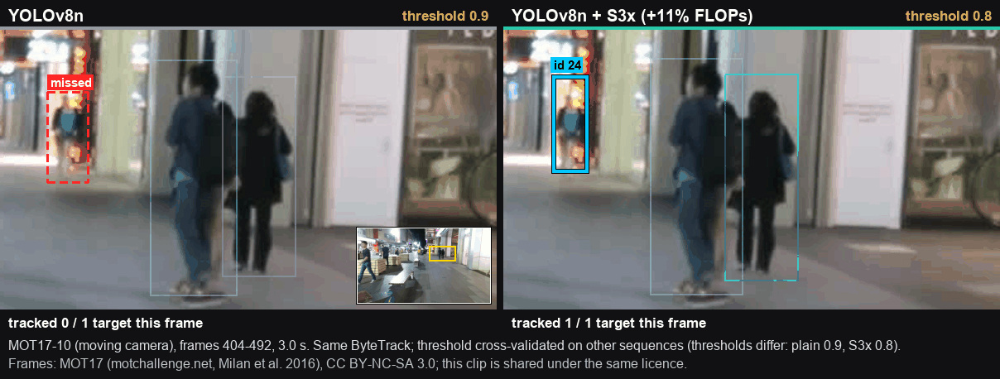

# Demo clips

Each clip compares plain (unmodified) YOLOv8n with YOLOv8n + S3x on far, small pedestrians. S3x changes four strides
inside YOLOv8n so that P3, its finest detection level, gets a grid twice as fine horizontally: cells 4 px wide by 8 px
tall instead of 8 x 8, for +11 % FLOPs. On a Jetson Orin Nano the 416 x 320 TensorRT FP16 engine takes 3.26 ms instead
of 2.94 ms ([`deploy/jetson/results/latency_orin_nano.md`](../deploy/jetson/results/latency_orin_nano.md)). Both
models are seed-0 runs of the same training code and use the same ByteTrack tracker.

**These are selected best cases, not average ones.** The averages over all sequences are in
[`results/RESULTS.md`](../results/RESULTS.md); the table below summarises them. Each cell gives two values, for
ByteTrack / OC-SORT: the pedestrian HOTA (the standard multi-object tracking score, 0-100) of S3x minus that of the
plain model, over all seeds. Tracker thresholds are cross-fitted: each sequence is scored at a threshold chosen on the
other sequences. n.s. = not significant (randomisation test, p >= 0.05 after Holm correction for multiple
comparisons). In the middle column both models use the same canvas (the detector input size): 416 x 320 on DSEC,
416 x 256 on BDD100K and MOT17, 640 x 384 on VisDrone. In the last column, the plain model gets a larger canvas of the
same FLOPs, given in brackets:

| dataset | S3x minus plain, same canvas | S3x minus plain, larger canvas of the same FLOPs |
|---|---|---|
| DSEC test | +5.88 / +5.49 | +2.24 / +2.81 (448 x 352) |
| BDD100K MOT val | +2.52 / +2.56 | +1.54 / +1.37 (480 x 256) |
| VisDrone2019-MOT test-dev | +2.58 / +3.05 | +0.07 / +0.22, n.s. (704 x 384) |
| MOT17 train, evaluation halves | +2.70, n.s. (p 0.125) / +2.12 | -0.51 / +0.77, n.s. (480 x 256) |

On MOT17 and VisDrone, the difference between S3x and the plain model on a larger input of the same FLOPs is not
significant. The plain model on a 640-wide canvas, at about twice the FLOPs, is ahead of S3x on DSEC and BDD100K; the
lead is significant on BDD100K only.

| file | what | licence |
|---|---|---|
| [`dsec_clear_1.gif`](dsec_clear_1.gif) / [`.mp4`](dsec_clear_1.mp4) | DSEC, two far pedestrians, crop, 3 s (lead clip) | CC BY-SA 4.0 |
| [`dsec_compare_2.gif`](dsec_compare_2.gif) / [`.mp4`](dsec_compare_2.mp4) | DSEC, same scene, full frame + 2x zoom, 7 s | CC BY-SA 4.0 |
| [`mot17_clear_1.gif`](mot17_clear_1.gif) / [`.mp4`](mot17_clear_1.mp4) | MOT17-10, one far pedestrian, moving camera, 3 s | CC BY-NC-SA 3.0 |
| [`grid_explainer.png`](grid_explainer.png) / [`.gif`](grid_explainer.gif) | why narrow objects are missed: P3 anchor centres on a narrow pedestrian | CC BY-NC-SA 3.0 |
| [`explainer.gif`](explainer.gif) | schematic explainer at the top of the main README (synthetic scene, not real data), 18 s | repository licence |

## How the clips were chosen

- **Thresholds.** Each model's ByteTrack detection threshold for a sequence is the one the cross-fitted protocol picks
  for its seed-0 run (`method()['thr']['cross']` in `efpmot.eval.protocol`): the threshold with the best HOTA pooled
  over the other sequences (leave-one-sequence-out). A sequence never chooses its own threshold, and no threshold was
  tuned on a clip.
- **Windows.** 3, 4 and 5 s long, sliding by 0.5 s, over every evaluation sequence: 480 windows on the 7 MOT17
  evaluation halves and 3,975 on the 13 DSEC test sequences.
- **Target.** A ground-truth pedestrian present in at least 70 % of the window (on MOT17, present means annotated
  visibility >= 0.5) and under 12 px on its short side at the model input in more than half of it.
  - S3x-only target: S3x tracks it in >= 70 % of those frames and plain in <= 30 %.
  - Plain-only target: the reverse.
- **Isolation tiers.** Three tiers set how isolated a target must be from other people:
  - strict: no other person box within one target width;
  - group: the same, but a box within that distance is allowed if it is itself a target (two far people walking
    together);
  - no_iso: no isolation rule.
- **Crop score.** The number of S3x-only targets inside the crop, minus 0.25 per other pedestrian in it, minus 1 per
  plain-only target in it, and minus 1 per S3x false-positive track in it beyond the first. A crop holding one S3x-only
  target and nothing else scores 1. The crop shown in the clip is the most centred position that contains the targets'
  trajectories and is no more cluttered than the crop used for selection.
- **Matching.** A track counts as tracking a target in a frame when TrackEval's CLEAR matching (the one behind MOTA)
  pairs it with the target at IoU >= 0.5. On MOT17, the evaluator's distractor preprocessing is applied as well.

**How rare such people are.** The table counts the people who qualify as an S3x-only or plain-only target in at least
one window, with no crop or clutter filter. A person is a distinct (sequence, ground-truth id) pair and counts once,
however many windows they qualify in. Each cell gives S3x-only / plain-only for one isolation tier.

| dataset | strict: S3x-only / plain-only | group | no_iso |
|---|---|---|---|
| MOT17 (7 halves, 480 windows) | 1 / 0 | 1 / 0 | 4 / 1 |
| DSEC (13 sequences, 3,975 windows) | 8 / 0 | 13 / 0 | 37 / 0 |

- MOT17 has few such people: only 65 ground-truth ids are present and small for most of at least one window, and
  almost all of them stand in crowds. In the no_iso tier, 20 of the 480 MOT17 windows contain a crop with an S3x-only
  target, and none of them reaches a crop score of 1.
- On DSEC, 32 of the 3,975 windows contain such a crop in the group tier, and 6 of them score >= 1.
- Fewer targets qualify in longer windows (DSEC strict tier: 8 at 3 s, 4 at 4 s, 2 at 5 s).

## `dsec_clear_1`: two far pedestrians, same threshold (lead clip)

*DSEC thun_01_b (driving), images 910-969 (3 s at 20 Hz). With the same ByteTrack threshold (0.4, cross-fitted on
the other sequences), plain YOLOv8n tracks the two far pedestrians in 14 % of their frames (17 of 120 target-frames,
2 targets in 60 images) and YOLOv8n + S3x in 100 % (120 of 120). Plain has 3 ID switches on the targets and S3x has 0.*
*Frames: DSEC (https://dsec.ifi.uzh.ch), CC BY-SA 4.0 (https://creativecommons.org/licenses/by-sa/4.0/); cropped,
enlarged and annotated with model tracks; the clip is shared under CC BY-SA 4.0.*

- The targets are about 7.2-8.5 x 20 px at the 416 x 320 model input.
- The clip comes from the group tier, and its crop holds no other pedestrian and no false-positive track of either
  model. It is rank 1 of the 32 DSEC windows with an S3x-only crop, tied on score with thun_02_a images 1600-1659.
- The misses are genuine: in only 7 of the 103 missed target-frames does plain have any box with IoU >= 0.1 on a
  target.
- Drawing: the clip opens on the full camera view with the crop marked (1 s). Then each of the two panels, one per
  model, shows a 284 x 160 crop of the 640 x 480 frame, enlarged 2.1x. Only the models' tracks are drawn, each with its
  track id in a small tag above the box. The pill-shaped label above each panel says whether the targets are tracked
  in that frame.
  **No ground-truth box is drawn**: the counts use the DSEC-Detection labels, which state no licence, so the labels
  themselves are not shown or redistributed. The last frame (held 2 s) shows the share of frames tracked and the ID
  switches.
- GIF and MP4: every 2nd image, 10 fps, 1208 x 416.

## `dsec_compare_2`: the same scene, full frame

*DSEC thun_01_b, images 840-979 (7 s), ByteTrack threshold 0.4 for both. Over the clip, plain tracks the small
pedestrians (< 12 px short side at the model input) in 40 of 187 small-pedestrian frames (21 %) and S3x in 151 (81 %).
Boxes are the ByteTrack pedestrian tracks (colour and number show the track id); the lower panels zoom 2x into the
white rectangle. The pill above each panel counts the small pedestrians tracked in that frame; the line below the zoom
shows the share tracked so far.*
*Frames: DSEC (https://dsec.ifi.uzh.ch), CC BY-SA 4.0 (https://creativecommons.org/licenses/by-sa/4.0/); resized,
zoomed and annotated with model tracks; the clip is shared under CC BY-SA 4.0.*

- `dsec_clear_1` is the same pair of people in a tighter 3 s window.
- No ground-truth box is drawn (same reason as above). GIF: every 2nd image at 10 fps (70 frames); MP4: every image at
  20 fps (140 frames); both 964 x 626.

## `mot17_clear_1`: one far pedestrian, moving camera

*MOT17-10 (moving camera), image frames 404-492 (3 s). A far pedestrian, ground-truth id 14, is about 6.7 x 15.6 px
at the 416 x 256 input (31 x 72 px in the 1920 x 1080 frame). Plain YOLOv8n tracks them in 0 % of their frames and
YOLOv8n + S3x in 75 % (0 vs 67 of 89 target-frames). Each model uses its own cross-fitted threshold (plain 0.9, S3x
0.8), and **the gap depends on the threshold**: at 0.8 for both it is 22 % vs 75 %, at 0.9 for both 0 % vs 0 %. S3x
switches the track id twice.*
*Frames and annotations: MOT17 (https://motchallenge.net), CC BY-NC-SA 3.0
(https://creativecommons.org/licenses/by-nc-sa/3.0/); cropped, enlarged and annotated with model tracks; the clip is
shared under CC BY-NC-SA 3.0, non-commercial use only.*

- Drawing (after a 1 s full camera view with the crop marked):
  - thick box in the track colour with its id above: the model's track is matched to the target in this frame
    (IoU >= 0.5);
  - red dashed box: the target is there and the model has no matching track;
  - pill above each panel: TRACKED or MISSED for the target in this frame; frames in which the target is annotated
    less than 50 % visible are not counted and get no pill or mark;
  - thin faint boxes: every other track of that model, for context.
- The misses are genuine: in only 4 of the 89 missed target-frames does plain have any box with IoU >= 0.1 on the
  target.
- The clip comes from the no_iso tier: the crop holds 4 other pedestrians (drawn faint). The crop is 384 x 216 px of
  the 1920 x 1080 frame, enlarged 1.56x.
- The MOT17 evaluation set is the second half of each training sequence (the standard half split), so the scene and
  the camera were seen in training.
- GIF and MP4: every 3rd frame, 10 fps, 1208 x 416; the totals on the last frame count all 30 fps frames.

## `grid_explainer`: why narrow objects are missed

*A real far pedestrian from MOT17-02, frame 361, annotated 86 % visible, is 4.3 x 12.6 px at the 416 x 256 model input.
No P3 anchor centre of plain YOLOv8n (8 x 8 px cells) lies inside the box, but 2 of S3x's (4 x 8 px cells) do. In that
frame plain misses this person and S3x tracks them (id 18).*
*Frame and annotation: MOT17 (https://motchallenge.net), CC BY-NC-SA 3.0
(https://creativecommons.org/licenses/by-nc-sa/3.0/); cropped, enlarged and annotated with the anchor grids; shared
under CC BY-NC-SA 3.0, non-commercial use only.*

- During training, YOLOv8's task-aligned assigner (TAL) only considers anchors (the grid cells where the detector
  predicts) whose centre lies inside a ground-truth box, so a box with no anchor centre inside gets no positive sample.
  Plain YOLOv8n has no P4 or P5 anchor centre inside this box either.
- Caveat: the two S3x anchor centres are only about 0.7 px inside the box edge, and the person stands in a crowd.
- The amber dashed box is the MOT17 ground-truth box (MOT17 annotations are CC BY-NC-SA 3.0); the legend under the
  figure names the white dots (P3 grid points) and the cyan ones (grid points inside the box).
  `grid_explainer.gif` is an animated version of the same figure.

## Licences and attribution

- **DSEC clips** (`dsec_clear_1`, `dsec_compare_2`): frames from DSEC (Gehrig et al., "DSEC: A Stereo Event Camera
  Dataset for Driving Scenarios", RA-L 2021; https://dsec.ifi.uzh.ch), CC BY-SA 4.0
  (https://creativecommons.org/licenses/by-sa/4.0/). **Changes:** the frames were cropped, resized and annotated with
  the models' tracks, text panels were added, and the frames were re-encoded as GIF / MP4. The clips are shared under
  CC BY-SA 4.0. No ground-truth box is drawn; the DSEC-Detection labels are not redistributed.
- **MOT17 clips and figure** (`mot17_clear_1`, `grid_explainer`): frames and annotations from MOT17 (Milan et al.,
  "MOT16: A Benchmark for Multi-Object Tracking", arXiv:1603.00831; https://motchallenge.net), CC BY-NC-SA 3.0
  (https://creativecommons.org/licenses/by-nc-sa/3.0/). **Changes:** the frames were cropped, resized and annotated
  with the models' tracks, ground-truth boxes or anchor grids, and re-encoded as GIF / MP4 / PNG. The derivatives are
  shared under CC BY-NC-SA 3.0: non-commercial use, with attribution, share alike. The attribution is also drawn on
  every frame.
- **Thermal Watch demo** (the video on YouTube and [`apps/thermal_watch/media/thermal_watch_demo.jpg`](../apps/thermal_watch/media/thermal_watch_demo.jpg)):
  frames of the HIT-UAV sample videos (Suo et al., "HIT-UAV: A high-altitude infrared thermal dataset for Unmanned
  Aerial Vehicle-based object detection", Scientific Data 2023; https://github.com/suojiashun/HIT-UAV-Infrared-Thermal-Dataset),
  CC BY 4.0 (https://creativecommons.org/licenses/by/4.0/). **Changes:** the frames were resized and drawn into the app
  screen (person markers, distances, alert cards), and re-encoded as MP4 / JPEG. Shared under CC BY 4.0. How the scenes
  were chosen: [`apps/thermal_watch/README.md`](../apps/thermal_watch/README.md).
- **Schematic explainer** (`explainer.gif`): an original illustration rendered from a synthetic 3D scene. It contains
  no dataset frames, labels or model outputs and is covered by the repository licence.
