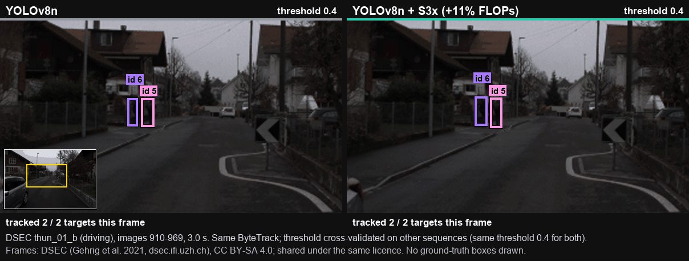
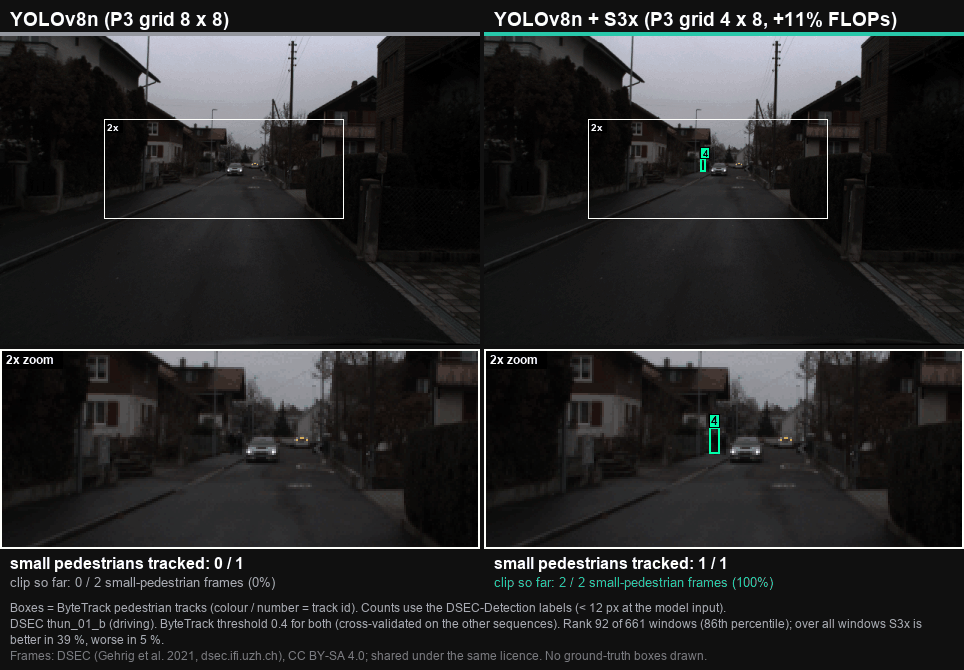
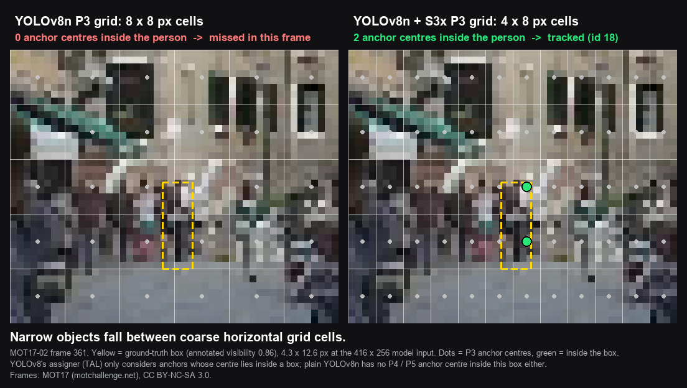

# Demo clips

Each clip compares plain YOLOv8n with YOLOv8n + S3x on far, small pedestrians. S3x gives the P3 stage a horizontal grid
twice as fine: cells 4 px wide by 8 px tall instead of 8 x 8, for +11 % FLOPs. On a Jetson Orin Nano the 416 x 320
FP16 engine takes 3.26 ms instead of 2.94 ms
([`deploy/jetson/results/latency_orin_nano.md`](../deploy/jetson/results/latency_orin_nano.md)). Both models come from
the same training code (seed 0) and run through the same ByteTrack tracker.

**These are selected best cases, not average windows.** The averages are in
[`results/RESULTS.md`](../results/RESULTS.md). Pedestrian HOTA, cross-fitted thresholds, all seeds, ByteTrack / OC-SORT;
n.s. = not significant (Holm-adjusted randomisation p >= 0.05). The second column spends the same FLOPs on a larger
uniform canvas instead:

| dataset | S3x minus plain, same canvas | S3x minus same-cost uniform canvas |
|---|---|---|
| DSEC test | +5.88 / +5.49 | +2.24 / +2.81 (448 x 352) |
| BDD100K MOT val | +2.52 / +2.56 | +1.54 / +1.37 (480 x 256) |
| VisDrone2019-MOT test-dev | +2.58 / +3.05 | +0.07 / +0.22, n.s. (704 x 384) |
| MOT17 train, evaluation halves | +2.70 (n.s., p 0.125) / +2.12 | -0.51 / +0.77, n.s. (480 x 256) |

On MOT17 and VisDrone, S3x and a uniform canvas of the same cost are tied, and a 640-wide canvas beats S3x on DSEC and
BDD100K at about twice the FLOPs.

| file | what | licence |
|---|---|---|
| [`dsec_clear_1.gif`](dsec_clear_1.gif) / [`.mp4`](dsec_clear_1.mp4) | DSEC, two far pedestrians, crop, 3 s (lead clip) | CC BY-SA 4.0 |
| [`dsec_compare_2.gif`](dsec_compare_2.gif) / [`.mp4`](dsec_compare_2.mp4) | DSEC, same scene, full frame + 2x zoom, 7 s | CC BY-SA 4.0 |
| [`mot17_clear_1.gif`](mot17_clear_1.gif) / [`.mp4`](mot17_clear_1.mp4) | MOT17-10, one far pedestrian, moving camera, 3 s | CC BY-NC-SA 3.0 |
| [`grid_explainer.png`](grid_explainer.png) / [`.gif`](grid_explainer.gif) | why: P3 anchor centres on a narrow pedestrian | CC BY-NC-SA 3.0 |
| [`explainer.gif`](explainer.gif) | schematic explainer at the top of the main README (synthetic scene, not real data), 18 s | repository licence |

## How the clips were chosen

- **Thresholds.** Each model's ByteTrack threshold for a sequence is the one the cross-fitted protocol picks for it
  (`efpmot.eval.protocol`, `method()['thr']['cross']`, seed 0, leave-one-sequence-out). A sequence never chooses its
  own threshold, and no clip chose its threshold.
- **Windows.** 3, 4 and 5 s long, sliding by 0.5 s, over every evaluation sequence: 480 windows on the 7 MOT17
  evaluation halves and 3,975 on the 13 DSEC test sequences.
- **Target.** A ground-truth pedestrian present in at least 70 % of the window (MOT17: annotated visibility >= 0.5) and
  under 12 px on its short side at the model input in more than half of it.
  - S3x-only target: S3x tracks it in >= 70 % of those frames and plain in <= 30 %.
  - Plain-only target: the reverse.
- **Isolation tiers.**
  - strict: no other person box within one target width;
  - group: the same, but a blocking box that is itself a target is allowed (two far people walking together);
  - no_iso: no isolation rule.
- **Crop score.** S3x-only targets inside the crop, minus 0.25 per other pedestrian in it, minus 1 per plain-only
  target in it, minus 1 per extra S3x false-positive track in it beyond one. The display crop is the most centred
  position that contains the targets' trajectories and is no more cluttered than the selection crop.
- **Matching.** A track counts as tracking a target in a frame when it is matched to it as in TrackEval CLEAR
  (IoU >= 0.5, with the evaluator's preprocessing: MOT17 distractors, DSEC crowd regions).

**How rare such people are.** Distinct (sequence, ground-truth id) over all windows, with no crop or clutter filter;
a person counts once if they qualify in at least one window.

| dataset | strict: S3x-only / plain-only | group | no_iso |
|---|---|---|---|
| MOT17 (7 halves, 480 windows) | 1 / 0 | 1 / 0 | 4 / 1 |
| DSEC (13 sequences, 3,975 windows) | 8 / 0 | 13 / 0 | 37 / 0 |

- MOT17 has few such people: only 65 ground-truth ids are ever present and small for most of a window, and almost
  all of them stand in crowds. 20 of the 480 MOT17 windows contain a crop with an S3x-only target (no_iso tier) and
  none reaches a crop score of 1.
- DSEC: 32 of the 3,975 windows (group tier) contain such a crop, and 6 score >= 1.
- Most targets qualify only in 3 s windows (DSEC strict tier: 8 at 3 s, 4 at 4 s, 2 at 5 s).

## `dsec_clear_1`: two far pedestrians, same threshold (lead clip)

*DSEC thun_01_b (driving), images 910-969 (3 s at 20 Hz). With the same ByteTrack threshold (0.4, cross-fitted on
the other sequences), plain YOLOv8n tracks the two far pedestrians in 14 % of their frames (17 of 120 target-frames)
and YOLOv8n + S3x in 100 % (120 of 120). ID switches on the targets: plain 3, S3x 0.*
*Frames: DSEC (https://dsec.ifi.uzh.ch), CC BY-SA 4.0 (https://creativecommons.org/licenses/by-sa/4.0/); cropped,
enlarged and annotated with model tracks; the clip is shared under CC BY-SA 4.0.*

- The targets are about 7.2-8.5 x 20 px at the 416 x 320 model input.
- The crop holds no other pedestrian and no false-positive track of either model (group tier). It is rank 1 of the
  32 DSEC windows with an S3x-only crop, tied on score with thun_02_a images 1600-1659.
- The misses are genuine: in only 7 of the 103 missed target-frames does plain have any box with IoU >= 0.1 on a
  target.
- Drawing: each panel is a 284 x 160 crop of the 640 x 480 frame, enlarged 2.1x; the thumbnail shows the crop on the
  full frame. Only the models' tracks are drawn. **No ground-truth box is drawn**: the counts use the DSEC-Detection
  labels, which state no licence, so the labels themselves are not shown or redistributed. The last frame (held 2 s)
  shows the clip totals.
- GIF and MP4: every 2nd image, 10 fps, 1208 x 458.

## `dsec_compare_2`: the same scene, full frame

*DSEC thun_01_b, images 840-979 (7 s), ByteTrack threshold 0.4 for both. Over the clip, plain tracks the small
pedestrians (< 12 px short side at the model input) in 40 of 187 small-pedestrian frames (21 %) and S3x in 151 (81 %).
Boxes are the ByteTrack pedestrian tracks (colour and number = track id); the lower panels zoom 2x into the white
rectangle.*
*Frames: DSEC (https://dsec.ifi.uzh.ch), CC BY-SA 4.0 (https://creativecommons.org/licenses/by-sa/4.0/); resized,
zoomed and annotated with model tracks; the clip is shared under CC BY-SA 4.0.*

- This window is rank 92 of 661 windows of this kind (86th percentile); over all of them S3x is better in 39 % and worse
  in 5 %. `dsec_clear_1` is the same pair of people in a tighter 3 s window.
- No ground-truth box is drawn (same reason as above). GIF: every 2nd image at 10 fps (70 frames); MP4: every image at
  20 fps (140 frames); both 964 x 670.

## `mot17_clear_1`: one far pedestrian, moving camera

*MOT17-10 (moving camera), image frames 404-492 (3 s). A far pedestrian (GT id 14, about 6.7 x 15.6 px at the 416 x 256
input; 31 x 72 px in the 1920 x 1080 frame) is tracked in 0 % of their frames by plain YOLOv8n and in 75 % by YOLOv8n +
S3x (0 vs 67 of 89 target-frames). Each model uses its own cross-fitted threshold (plain 0.9, S3x 0.8), and **the gap
depends on it**: at 0.8 for both it is 22 % vs 75 %, at 0.9 for both 0 % vs 0 %. S3x switches the track id twice.*
*Frames and annotations: MOT17 (https://motchallenge.net), CC BY-NC-SA 3.0
(https://creativecommons.org/licenses/by-nc-sa/3.0/); cropped, enlarged and annotated with model tracks; the clip is
shared under CC BY-NC-SA 3.0, non-commercial use only.*

- Drawing:
  - thick box in the track colour with "id N": the model's track is matched to the target in this frame (IoU >= 0.5);
  - red dashed box, "missed": the target is there and the model has no matching track;
  - grey dashed box, "occluded": the target is annotated less than 50 % visible and is not counted;
  - thin faint boxes: every other track of that model, for context.
- The misses are genuine: in only 4 of the 89 missed target-frames does plain have any box with IoU >= 0.1 on the
  target.
- Isolation: no_iso tier; the crop holds 4 other pedestrians (drawn faint). The crop is 384 x 216 px of the 1920 x 1080
  frame, enlarged 1.56x.
- The MOT17 evaluation set is the second half of each training sequence (the standard half split), so the scene and
  the camera were seen in training.
- GIF and MP4: every 3rd frame, 10 fps, 1208 x 458; the totals on the last frame count all 30 fps frames.

## `grid_explainer`: why narrow objects are missed

*A real far pedestrian from MOT17-02, frame 361, annotated 86 % visible, is 4.3 x 12.6 px at the 416 x 256 model input.
No P3 anchor centre of plain YOLOv8n (8 x 8 px cells) lies inside the box, but 2 of S3x's (4 x 8 px cells) do. In that
frame plain misses this person and S3x tracks them (id 18).*
*Frame and annotation: MOT17 (https://motchallenge.net), CC BY-NC-SA 3.0
(https://creativecommons.org/licenses/by-nc-sa/3.0/); cropped, enlarged and annotated with the anchor grids; shared
under CC BY-NC-SA 3.0, non-commercial use only.*

- YOLOv8's task-aligned assigner (TAL) only considers anchors whose centre lies inside a ground-truth box, so a box with
  no anchor centre inside gets no positive sample in training. Plain YOLOv8n has no P4 or P5 anchor centre inside this
  box either.
- Honest detail: the two S3x anchor centres are only about 0.7 px inside the box edge, and the person stands in a
  crowd. `grid_explainer.gif` is an animated version of the same figure.
- The yellow box is the MOT17 ground-truth box (MOT17 annotations are CC BY-NC-SA 3.0).

## Licences and attribution

- **DSEC clips** (`dsec_clear_1`, `dsec_compare_2`): frames from DSEC (Gehrig et al., "DSEC: A Stereo Event Camera
  Dataset for Driving Scenarios", RA-L 2021; https://dsec.ifi.uzh.ch), CC BY-SA 4.0
  (https://creativecommons.org/licenses/by-sa/4.0/). **Changes:** the frames were cropped, resized and annotated with
  the models' tracks, text panels were added, and the frames were re-encoded as GIF / MP4. The clips are shared under
  CC BY-SA 4.0. No ground-truth box is drawn; the DSEC-Detection labels are not redistributed.
- **MOT17 clips and figure** (`mot17_clear_1`, `grid_explainer`): frames and annotations from MOT17 (Milan et al.,
  "MOT16: A Benchmark for Multi-Object Tracking", arXiv:1603.00831; https://motchallenge.net), CC BY-NC-SA 3.0
  (https://creativecommons.org/licenses/by-nc-sa/3.0/). **Changes:** the frames were cropped, resized and annotated
  with the models' tracks, ground-truth boxes or anchor grids, and re-encoded as GIF / MP4 / PNG. The derivatives are
  shared under CC BY-NC-SA 3.0: non-commercial use, with attribution, share alike. The attribution is also drawn on
  every frame.
- The zone-alert app media are in [`apps/zone_alert/demo/`](../apps/zone_alert/demo/) (MOT17, CC BY-NC-SA 3.0).
- **Schematic explainer** (`explainer.gif`): an original illustration rendered from a synthetic 3D scene. It contains
  no dataset frames, labels or model outputs and is covered by the repository licence.
