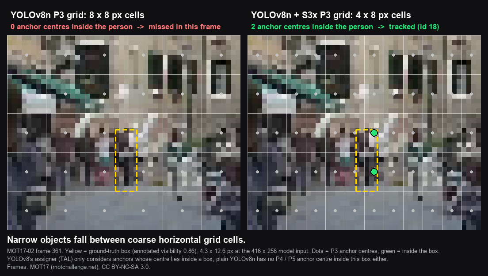

# Method: the short-side rule and the S3x module

## 1. The finding: a far object is missed when its short side falls below about one P3 stride

On an edge detector the input canvas is small (416 x 320 for DSEC, 416 x 256 for 16:9 street and driving video). A far
pedestrian is then only a few pixels wide on the canvas. YOLOv8n's finest output level, P3, has one anchor point every
8 px in both directions.

**Pedestrians are width-limited, cars are height-limited.** In the measurements below, detection follows the object's
*short side* on the canvas, not its area:

- A pedestrian is about 2-3 times taller than wide, so its short side is its width.
- A car seen from the road or from a drone is wider than tall, so its short side is its height.

**Evidence from uniform-canvas detectors (DSEC val, held out, YOLOv8n at 416 x 320, 3 seeds pooled).** A logistic
regression of "detected" (a same-class box with IoU >= 0.5 and score >= 0.5) on log canvas width and log canvas height
of each visible ground-truth object (no other labelled box covers more than 10 % of it, fully inside the frame;
standard errors clustered by GT track):

| class | objects x seeds | coefficient of log width (SE) | coefficient of log height (SE) |
|---|---|---|---|
| pedestrian | 11,661 | +2.57 (0.48) | +0.15 (0.54) |
| car | 37,626 | +0.03 (0.29) | +2.87 (0.33) |

- For pedestrians, height adds nothing once width is in the model. Cars are the mirror case.
- In paired comparisons, where the same objects are seen by two detectors with different canvas geometry, a log-unit
  of width moves the pedestrian hit rate 6 to 8 times as much as a log-unit of height.
- These two analyses need DSEC val detection caches and were computed with analysis code that is not part of this
  repository; the numbers are reported as text. The ground-truth table below is reproducible from the repository.

**Ground-truth geometry: how many objects fall below one stride.** These are the measurements fixed before any
VisDrone or MOT17 training ([`PREREGISTRATION.md`](PREREGISTRATION.md)). Frames letterboxed to a long side of 416 /
640 px. Reproduce with `python -B scripts/short_side_stats.py` (ground truth only, CPU, about 15 s; it prints this
table exactly).

| data | class | boxes | median w / h | width is the short side | short side < 8 px at 416 / 640 |
|---|---|---|---|---|---|
| VisDrone2019-MOT train+val | pedestrian | 266,709 | 0.47 | 98 % | 76 % / 40 % |
| VisDrone2019-MOT train+val | people | 112,304 | 0.61 | 93 % | 71 % / 33 % |
| VisDrone2019-MOT train+val | car | 537,122 | 1.26 | 26 % | 37 % / 12 % |
| MOT17 train (FRCNN, visibility >= 0.25) | pedestrian | 85,828 | 0.35 | 100 % | 18 % / 8 % |

At 640, 97 % of the VisDrone pedestrians below 8 px are narrow on their width; 86 % of the small cars are short on their
height.

**Why the assigner makes this sharp.** YOLOv8's task-aligned assigner (TAL) only considers anchors whose centre lies
inside a ground-truth box. A box narrower than the 8 px anchor spacing can fall between two anchor columns. It then gets
no positive anchor at P3 (and none at P4 / P5), so it is trained as background.

*MOT17-02, frame 361: a pedestrian 4.3 x 12.6 px at the 416 x 256 input has no plain P3 anchor centre inside its box
and two with S3x.*

## 2. The S3x module

S3x refines the P3 grid along the short side of the target class. For pedestrians this is the horizontal axis: P3 runs
at stride 8 vertically and 4 horizontally. It is a re-arrangement of strides inside the existing YOLOv8n graph, with no
new operator. The P3 level keeps its full depth, and P4 / P5 are unchanged.

### Layer edits (YOLOv8n, Ultralytics 8.3.170 `yolov8n.yaml`, strides as (y, x))

| layer | plain YOLOv8n | S3x | S3y (control) |
|---|---|---|---|
| 3: Conv P2 -> P3 | stride (2, 2) | stride **(2, 1)** | stride (1, 2) |
| 5: Conv P3 -> P4 | stride (2, 2) | stride **(2, 4)** | stride (4, 2) |
| 13: Upsample P4 -> P3 | scale 2 | **`AUpsample` scale (2, 4)** | scale (4, 2) |
| 16: Conv P3 -> P4 (bottom-up) | stride (2, 2) | stride **(2, 4)** | stride (4, 2) |
| P3 head (box and cls branches) | 64 ch | **32 ch** | 32 ch |
| P3 grid at 416 x 320 | 40 x 52 (stride 8 x 8) | 40 x 104 (stride 8 y, 4 x) | 80 x 52 (stride 4 y, 8 x) |

- P2 has stride 4 in both axes. Layer 3 with stride (2, 1) gives P3 a stride of 8 (y) by 4 (x).
- Layer 5 with stride (2, 4) brings P4 back to 16 x 16, so P4, P5 and everything after them are the plain YOLOv8n
  layers.
- The top-down upsample (layer 13) and the bottom-up conv (layer 16) mirror this with scale / stride (2, 4).
- `AUpsample` (`efpmot/models/aniso.py`) is `nn.Upsample` with a per-axis scale tuple. Importing `efpmot.models`
  registers it under `torch.nn` so that the Ultralytics model parser finds it. It exports to an ONNX `Resize` with
  scales (1, 1, 2, 4).
- The strided convolutions keep their 3 x 3 kernels, so every backbone and neck tensor loads from the COCO
  `yolov8n.pt` checkpoint by name and shape.
- **Thinned P3 head.** P3 now has twice as many anchors. Thinning its two head branches from 64 to 32 channels keeps the
  cost at about +11 %:

  | model | GFLOPs at 416 x 320, 8 classes |
  |---|---|
  | YOLOv8n | 2.665 |
  | YOLOv8n + S3x | 2.955 (+10.9 %) |

  The thinned box branch starts from the leading channels of the COCO P3 box branch. The class branches start fresh at
  every level, as in the plain model (COCO has 80 classes, these models have 8).
- **S3y** is the transposed module (stride 4 vertically, 8 horizontally), at the same cost. It is the control: if the
  short-side rule is right, S3y should help cars, which are height-limited, and not pedestrians.

### Per-axis anchors, decoding and loss

- **Anchors.** `AnisoDetect` stores a per-level stride pair `stride_xy = (sx, sy)`, measured from a probe forward pass
  (sx = W_in / W_level, sy = H_in / H_level). Anchor points are generated per axis, at cell centres
  ((i + 0.5) sx, (j + 0.5) sy).
- **Decoding.** The DFL distances (left, top, right, bottom) are predicted in per-axis grid units and scaled by
  (sx, sy, sx, sy). At P3 of S3x, one horizontal unit is 4 px and one vertical unit is 8 px. The classification prior
  bias uses sqrt(sx * sy).
- **Loss.** `AnisoV8Loss` is the Ultralytics 8.3.170 `v8DetectionLoss` with the stride tensors made per-axis:
  - The task-aligned assigner works on pixel boxes and pixel anchor points, so a narrow box now covers anchor centres
    of the 4 px columns.
  - CIoU is computed on pixel boxes: CIoU is not invariant to per-axis scaling, so it cannot be computed in grid units.
  - The DFL targets are the pixel distances divided by the per-axis stride and clipped to the 16-bin range.
  - The BCE classification loss and the loss weights (box 7.5, cls 0.5, dfl 1.5) are unchanged.
- **Inference.** It is the plain Ultralytics pipeline: sigmoid scores, class-wise NMS.

### The YOLO11n port

YOLO11n has the same P2 -> P3 -> P4 structure at different indices. The four edits sit at layers 3, 5, 14
(upsample) and 17 (bottom-up conv). The YOLO11 head (box branch Conv-Conv-Conv2d; class branch with depth-wise convs) is
thinned to **24 channels** at P3.

- The width was chosen by a rule declared before measuring: among 16, 24, 32, 48 and 64 channels, take the one whose
  overhead is closest to the YOLOv8n S3x overhead (+10.9 %).
- YOLO11n costs 2.101 GFLOPs and YOLO11n + S3x 2.333 GFLOPs (+11.0 %).
- The loss and the per-axis anchors are shared with the YOLOv8n port.

Code: `efpmot/models/aniso.py` (YOLOv8n, `AUpsample`, `AnisoDetect`, `AnisoV8Loss`), `efpmot/models/aniso_y11.py`
(YOLO11n) and `efpmot/models/adapters.py` (training / inference interface).

## 3. Training and evaluation in brief

- **Training.** Every arm is trained from the COCO checkpoint with one shared harness:
  - batch 16, AdamW, lr 0.000833, weight decay 5e-4;
  - linear warm-up, then a cosine decay to 0.05 x lr;
  - FP16;
  - per frame pair: a horizontal flip, a 0.8-1.2 resize and one brightness gain, then the letterbox. The letterbox
    rescales the frame to the canvas, so the resize hardly changes object sizes on the canvas: in effect there is no
    scale augmentation;
  - 6 epochs on DSEC, VisDrone and BDD100K; 55 epochs on MOT17, whose training set is about 9 times smaller.
- **Same tracker for every detector.** ByteTrack and OC-SORT (BoxMOT 25.0) with fixed settings: buffer 15 frames,
  match 0.8, one tracker per class. Only the detection threshold is chosen per sequence.
- **Threshold choice.** The threshold of each held-out sequence is chosen by leave-one-sequence-out cross-fitting on the
  other sequences (10 video folds on BDD100K), so no sequence chooses its own threshold.
- **Comparison.** HOTA is recombined exactly from per-sequence TrackEval statistics and compared with a paired
  hierarchical bootstrap (sequences, then seeds), a paired randomisation test and TOST equivalence against frozen
  margins.

Details: [`PROTOCOL.md`](PROTOCOL.md). Results: [`results/RESULTS.md`](../results/RESULTS.md).

## 4. Relation to prior work

Non-square strides and axis-specific feature grids exist before this work: the (2, 1) strides of text recognisers,
LaserNet's range-image grids, and MatrixNets' aspect-ratio-specific layers. S3x is not a new operator. What this
project adds:

- the measured short-side regularity that says *which* axis to refine for *which* class (S3y is the falsification test);
- a placement of the refinement at P3 at a fixed +11 % budget;
- the comparison, under one tracking protocol, against compute-matched uniform canvases, a P2 level and a shallow
  MatrixNets-style branch, with the latency of each measured on a Jetson Orin Nano.

The alternatives that were tried and dropped are in [`EXPERIMENTS_LOG.md`](EXPERIMENTS_LOG.md).
